# Prova AEDI — Risco Cibernético por Simulação de Monte Carlo (ANDI)

**Relatório técnico — Grupo 5 — semente 202605**
Disciplina: Análise Estatística de Dados e Informações (PPCA) — Prof. João Carlos Félix Souza

> **RASCUNHO PARA REVISÃO DO GRUPO.** Texto e código produzidos com apoio de IA (ver `memorial_ia.md`). Todos os números vêm de `saidas/resultados.md`, gerado por `uv run python main.py --grupo 5`. As interpretações precisam ser conferidas, ajustadas e assumidas pelo grupo antes da entrega.

Convenções: α = 5%; valores em reais; "mi" = milhões. Tabelas completas em `saidas/tabelas/` e figuras em `saidas/figuras/`.

---

## Parte A — O modelo gerador

### Questão 1 — Implementação

**a) Os quatro passos da Seção 12.2 no código.** O gerador está em `andi/gerador.py`, e o cabeçalho do módulo registra a correspondência:

| Passo (Seção 12.2) | Onde está | O que faz |
|---|---|---|
| 1. Modelar | `parametros.py`; `taxa_trimestral`, `taxa_mensal`, `prob_materializacao`, `log_mediana_perda` | Distribuições, coeficientes e as relações entre entradas e saídas |
| 2. Sortear | `gerar_unidades` (A1), `sortear_ataques` (A2–A5), com `sorteio.py` | Um valor de cada entrada incerta, por transformação inversa de U |
| 3. Calcular | `sortear_ataques`, `montar_bases`, `derivar_painel_trimestral`, `derivar_serie_mensal` | Taxa → contagem → atributos → pᵢ → perda; depois as cinco bases |
| 4. Analisar | `parte_a.py`, `parte_b*.py`, `parte_c.py` | Verificação, capítulos 1 a 11 e a SMC de decisão |

O comando único recria as bases bit a bit (conferido: duas execuções produzem `ataques.csv` idêntico). Resultado com a semente 202605: 24 unidades (13 com SOC), **3.063 ataques**, **1.288 perdas**, painel de 288 linhas e série de 36 meses.

Decisões de implementação que o enunciado deixa em aberto (todas documentadas no código):

- Gerador uniforme: PCG64 do NumPy, um único fluxo iniciado com a semente; ordem fixa dos sorteios A1 → A2 → A3 → A4 → A5.
- Fevereiro tem sempre 28 dias (o enunciado fixa "28, 30 ou 31"), inclusive em 2024.
- Arredondamentos: patch e treino com 2 casas, cvss com 1, tempo com 2, perda em centavos. O logit e a severidade usam os valores já arredondados, de modo que os CSV bastam para reconstruir pᵢ.
- As análises da Parte B leem os CSV gravados, não os objetos em memória.

**b) Como cada distribuição sai de um uniforme.** Todas usam a transformação inversa X = F⁻¹(U), U ~ Uniforme[0, 1):

| Distribuição | Uso | Transformação |
|---|---|---|
| Uniforme contínua (a; b) | treino | x = a + (b − a)·U |
| Uniforme discreta {a..b} | servicos, dia | x = a + ⌊(b − a + 1)·U⌋ |
| Bernoulli (p) | soc, fora_expediente, materializou | x = 1 se U < p |
| Categórica | tipo | menor k com p₁ + … + p_k > U |
| **Triangular (a; c; b)** | patch, cvss | F_c = (c − a)/(b − a). Se U < F_c: x = a + √(U(b − a)(c − a)); senão: x = b − √((1 − U)(b − a)(b − c)) |
| **Exponencial (θ)** | tempo de detecção | F(x) = 1 − e^(−x/θ) ⇒ x = −θ·ln(1 − U) |
| Poisson (λ) | contagem mensal | menor n com F(n; λ) ≥ U (busca na acumulada) |
| Normal | ruído da perda | z = Φ⁻¹(U), inversão numérica |

A Triangular e a Exponencial foram escritas à mão (`sorteio.py`) e comparadas com as funções prontas em 200.000 sorteios:

| | Triangular (60; 80; 95) | Exponencial θ = 4 | Exponencial θ = 12 |
|---|---:|---:|---:|
| Média teórica | 78,333 | 4,000 | 12,000 |
| Média F⁻¹ própria | 78,352 | 4,010 | 12,030 |
| Média NumPy | 78,311 | 3,996 | 12,027 |
| Desvio teórico | 7,169 | 4,000 | 12,000 |
| Desvio F⁻¹ própria | 7,167 | 4,010 | 12,030 |
| Máx. \|própria − ppf SciPy\| (mesmo U) | 0,00000 | 0,00000 | 0,00000 |
| KS p-valor (própria) | 0,308 | 0,308 | 0,308 |
| KS p-valor (NumPy) | 0,009 | 0,493 | 0,318 |

Com o mesmo U, a inversa própria coincide com a `ppf` do SciPy até a precisão de máquina, e médias e desvios ficam a menos de 0,3% do teórico. O p-valor KS é igual nas três colunas da inversa própria porque as três usam o mesmo U e a estatística KS não muda sob transformação monótona. O p = 0,009 da amostra NumPy da Triangular é flutuação: repetindo com oito outras sementes, os p-valores ficaram entre 0,21 e 1,00.

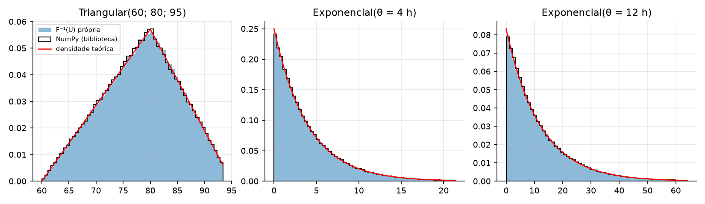

**c) Justificativa das distribuições (tabela da Seção 12.4).**

| Entrada | Distribuição | Por quê |
|---|---|---|
| Nº de ataques por unidade-mês | Poisson | Contagem de ocorrências por período |
| soc, fora_expediente, materializou | Bernoulli | Ocorre / não ocorre |
| tipo | Categórica | Generalização da Bernoulli para seis categorias |
| patch, cvss | Triangular | Incerteza limitada: só se conhece mínimo, moda e máximo |
| servicos, treino, dia | Uniforme | Só a faixa plausível, sem valor preferido |
| tempo de detecção | Exponencial | Tempo de espera até um evento |
| perda | Lognormal | Positiva, assimétrica, de cauda pesada |

Usar a Normal para a severidade seria grave por três motivos, e os dados confirmam cada um. Com a média (R$ 72.709) e o desvio (R$ 171.283) observados, uma Normal daria 33,6% de probabilidade a perdas negativas, que não existem. Ela é simétrica, enquanto a perda tem assimetria 10,0 e 76% dos casos abaixo da média. E ela subestima a cauda: sob a Normal, a maior perda (R$ 3,41 mi) estaria a 19,5 desvios da média, evento impossível, mas ela ocorreu em 1.288 observações. Como 10% das perdas respondem por 52% do valor perdido (Questão 4-b), errar a cauda é errar o risco.

### Questão 2 — Verificação do gerador

**a) Média mensal por unidade.** A tabela `q02a_media_unidade` compara, para cada unidade, a média observada em 36 meses com a média de λ_{u,t}. No agregado, foram 3.063 ataques contra 3.151,3 esperados (z = −1,57): compatível. Por unidade, 5 das 24 ficaram além de ±1,96 erro padrão (U03, z = −2,63; U17, +2,24; U18, −1,98; U22, +2,14; U24, −2,23), contra 1,2 esperada. Como quatro delas estão na fronteira, o teste conjunto é mais informativo: Σz² = 32,5 com 24 graus de liberdade, p = 0,116. Não há evidência de erro no gerador. Uma checagem independente, com 2.000 histórias de 36 meses, deu diferença máxima de 0,013 ataque/mês entre a média simulada e λ̄ de qualquer unidade.

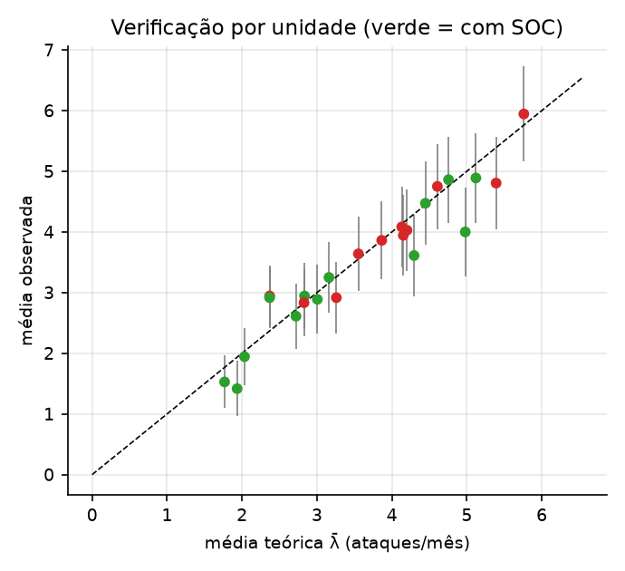

**b) Variância x média.** Dentro de cada unidade sem SOC, o índice de dispersão (variância/média) variou de 0,81 a 1,36, com média 1,02: é o que a Poisson exige. O valor não é exatamente 1 por dois motivos: são só 36 observações por unidade, e λ muda no tempo (tendência, sazonalidade, campanha), o que soma Var(λ_t) à variância.

Juntando as 864 unidades-mês, a média é 3,55 e a variância 4,99: índice de 1,41. A decomposição explica: a variância total é a média das variâncias internas (3,90) mais a variância entre as médias das unidades (1,20). Cada unidade é Poisson com a sua taxa, mas a mistura de taxas diferentes é superdispersa. Para a ANDI, isso significa que um único λ "médio" para todas as unidades subestimaria a variabilidade; a taxa precisa depender do perfil, como faz a regressão da Questão 11.

**c) Tipos e materialização.**

| Tipo | Programada | Observada | Diferença | Erro de simulação | z |
|---|---:|---:|---:|---:|---:|
| Phishing | 0,350 | 0,3366 | −0,0134 | 0,0086 | −1,56 |
| Força bruta | 0,200 | 0,2040 | +0,0040 | 0,0072 | +0,56 |
| Malware | 0,150 | 0,1610 | +0,0110 | 0,0065 | +1,70 |
| Exploração de vuln. | 0,150 | 0,1430 | −0,0070 | 0,0065 | −1,09 |
| DDoS | 0,100 | 0,1084 | +0,0084 | 0,0054 | +1,55 |
| Ransomware | 0,050 | 0,0470 | −0,0030 | 0,0039 | −0,76 |

Todas as diferenças estão dentro de ±1,96·√(p(1−p)/n); o qui-quadrado de aderência dá 7,98 (5 g.l.), p = 0,158. A taxa de materialização foi 42,05%, contra 43,04% de média dos pᵢ; com erro de simulação de 0,79 p.p., z = −1,25. As diferenças têm a ordem de grandeza σ/√n da Seção 12.3: com n ≈ 3.000, uma proporção é estimada com cerca de ±1 a ±2 p.p. Para cortar esse erro pela metade seriam precisos 12.000 ataques.

---

## Parte B — Análise das bases

### Questão 3 — Dos dados à decisão (cap. 1)

**a) Classificação.**

| Coluna | Tipo de variável |
|---|---|
| id_ataque, id_perda | Qualitativa nominal (identificador) |
| unidade, tipo | Qualitativa nominal |
| data | Quantitativa contínua (tempo), tratada como discreta em dias |
| ano, mes, trimestre | Quantitativa discreta (ordinais quando usadas como rótulo de período) |
| fora_expediente, materializou | Qualitativa nominal binária |
| cvss | Quantitativa contínua (escala de 0 a 10, registrada com 1 casa) |
| tempo_deteccao_h, perda_rs | Quantitativa contínua |

Quanto à estrutura, `ataques.csv` e `perdas.csv` são dados em nível de evento (uma linha por ocorrência, com data); `unidades.csv` é corte transversal; `serie_mensal.csv` é série temporal; `painel_trimestral.csv` é painel (24 unidades × 12 trimestres).

- **População:** todos os ataques que o processo gerador da ANDI pode produzir, incluindo os de 2026.
- **Amostra:** os 3.063 ataques de janeiro de 2023 a dezembro de 2025.
- **Unidade de observação:** o ataque (ou a unidade-trimestre e o mês, nas bases derivadas).
- **Parâmetros:** os valores populacionais desconhecidos para o analista: taxa de ataques, probabilidade de materialização, média e dispersão da perda, coeficientes dos modelos.

**b) Distribuições de frequências.** Phishing é o tipo mais frequente (1.031; 33,7%), seguido de força bruta (625; 20,4%), malware (493; 16,1%), exploração de vulnerabilidade (438; 14,3%), DDoS (332; 10,8%) e ransomware (144; 4,7%). Os três primeiros acumulam 70,2%.

Para `perda_rs`, Sturges dá K = 1 + 3,322·log₁₀(1.288) = 11,3 ≈ 11 classes; com início em 0 e amplitude conveniente de R$ 310.000:

| Classe (R$) | f | fr | F | Fr |
|---|---:|---:|---:|---:|
| 0 ⊢ 310.000 | 1.247 | 0,9682 | 1.247 | 0,9682 |
| 310.000 ⊢ 620.000 | 25 | 0,0194 | 1.272 | 0,9876 |
| 620.000 ⊢ 930.000 | 6 | 0,0047 | 1.278 | 0,9922 |
| 930.000 ⊢ 1.240.000 | 4 | 0,0031 | 1.282 | 0,9953 |
| 1.240.000 ⊢ 1.550.000 | 3 | 0,0023 | 1.285 | 0,9977 |
| 1.550.000 ⊢ 1.860.000 | 1 | 0,0008 | 1.286 | 0,9984 |
| 1.860.000 ⊢ 2.170.000 | 1 | 0,0008 | 1.287 | 0,9992 |
| 2.170.000 ⊢ 3.100.000 (3 classes) | 0 | 0 | 1.287 | 0,9992 |
| 3.100.000 ⊢ 3.410.000 | 1 | 0,0008 | 1.288 | 1,0000 |

A tabela mostra a forma da variável: 96,8% das perdas na primeira classe e uma cauda longa até R$ 3,4 mi. Classes de mesma amplitude descrevem mal uma variável assim; em ln(perda) as mesmas 11 classes formam um sino quase simétrico (tabela `q03b_classes_ln_perda`).

**c) Média, mediana e moda.**

| Tipo | n | Média | Mediana | Moda (Czuber) | Média/mediana |
|---|---:|---:|---:|---:|---:|
| Phishing | 386 | 34.144 | 19.881 | 10.091 | 1,72 |
| Força bruta | 193 | 20.529 | 13.178 | 7.465 | 1,56 |
| Malware | 220 | 62.053 | 39.154 | 25.768 | 1,58 |
| Exploração de vuln. | 245 | 97.260 | 57.654 | 35.240 | 1,69 |
| DDoS | 138 | 56.124 | 38.039 | 18.983 | 1,48 |
| Ransomware | 106 | 295.111 | 149.281 | 102.189 | 1,98 |
| **Geral** | 1.288 | 72.709 | 31.711 | 10.991 | 2,29 |

A moda foi calculada por Czuber com classes mais finas (amplitude 2·AIQ/n^(1/3)), porque com as classes de Sturges a classe modal é sempre a primeira e a fórmula devolve um valor sem sentido.

A ordem moda < mediana < média, em todos os tipos, é a assinatura da assimetria à direita. A **mediana** representa melhor a perda típica de um incidente: metade dos incidentes custa menos de R$ 31,7 mil, e só 23,9% custam mais que a média. A média é puxada por poucos eventos extremos. Ela continua sendo a medida certa para orçamento, porque a perda anual é a soma das perdas e somas dependem da média. A leitura para a diretoria: o incidente típico custa cerca de R$ 32 mil, mas o orçamento deve prever R$ 73 mil por incidente.

### Questão 4 — Dispersão, formato e associação (cap. 2)

**a) Dispersão por tipo.**

| Tipo | Desvio-padrão | CV | AIQ | AIQ/mediana |
|---|---:|---:|---:|---:|
| Phishing | 72.552 | 2,13 | 29.954 | 1,51 |
| Força bruta | 20.087 | 0,98 | 18.873 | 1,43 |
| Malware | 76.229 | 1,23 | 52.890 | 1,35 |
| Exploração de vuln. | 131.536 | 1,35 | 83.253 | 1,44 |
| DDoS | 66.912 | 1,19 | 54.078 | 1,42 |
| Ransomware | 467.954 | 1,59 | 186.853 | 1,25 |

Em termos absolutos o ransomware domina: desvio de R$ 468 mil, seis vezes o do phishing. Em termos relativos, o maior CV é o do **phishing** (2,13), seguido do ransomware (1,59). O CV do phishing é inflado por uma única perda de R$ 1,15 mi, de um ataque detectado só após 120,8 h; a medida robusta AIQ/mediana fica entre 1,25 e 1,51 para todos os tipos. Isso é coerente com um mesmo σ logarítmico para todos: a dispersão relativa é parecida entre tipos, e o que muda é a escala. Todos os CV ficam perto ou acima de 1: em qualquer tipo, o desvio é do tamanho da média.

**b) Box-plots e outliers.**

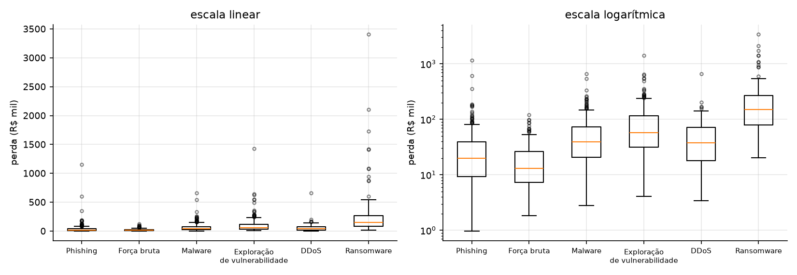

| Tipo | Cerca superior (R$) | Outliers acima | % das perdas | % do valor do tipo |
|---|---:|---:|---:|---:|
| Phishing | 84.095 | 24 | 6,2 | 35,3 |
| Força bruta | 54.434 | 13 | 6,7 | 25,6 |
| Malware | 153.116 | 21 | 9,5 | 37,3 |
| Exploração de vuln. | 239.830 | 19 | 7,8 | 33,5 |
| DDoS | 153.042 | 5 | 3,6 | 17,5 |
| Ransomware | 546.748 | 11 | 10,4 | 49,7 |

Não há outliers abaixo (as cercas inferiores são negativas). No conjunto, 130 perdas (10,1%) estão acima da cerca e somam **52,3% de todo o valor perdido**. Esses pontos não são erros de registro: são o resultado esperado de uma distribuição de cauda pesada, e em escala logarítmica quase desaparecem. Removê-los cortaria metade do risco da base e levaria a um VaR falsamente baixo. São a essência do risco e devem ficar.

**c) Assimetria e curtose.**

| | perda_rs | ln(perda_rs) |
|---|---:|---:|
| Assimetria | 10,02 | 0,24 |
| Curtose (Normal = 3) | 148,9 | 3,21 |
| Média / mediana | 72.709 / 31.711 | 10,40 / 10,36 |

O logaritmo transforma uma distribuição extremamente assimétrica e leptocúrtica em algo muito próximo da Normal: assimetria quase nula, curtose 3,2, média e mediana praticamente iguais. É a evidência descritiva de que a perda é aproximadamente Lognormal. A leve assimetria que sobra (0,24) vem da mistura de tipos e do efeito do tempo de detecção.

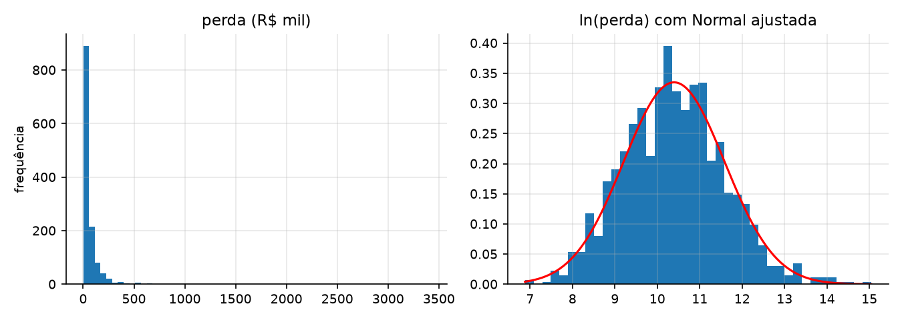

**d) Covariâncias e correlações (painel, n = 288).**

| | n_ataques | perda_total | servicos | patch | treino | soc |
|---|---:|---:|---:|---:|---:|---:|
| n_ataques | 1 | 0,400 | 0,619 | −0,040 | −0,195 | −0,253 |
| perda_total | | 1 | 0,204 | 0,008 | −0,114 | −0,331 |
| servicos | | | 1 | −0,060 | 0,002 | −0,163 |
| patch | | | | 1 | 0,073 | −0,319 |
| treino | | | | | 1 | −0,080 |
| soc | | | | | | 1 |

A matriz de covariâncias (tabela `q04d_covariancias`) tem os mesmos sinais, mas magnitudes incomparáveis por causa das unidades (a variância de perda_total é 2,5 × 10¹¹). Os sinais seguem o esperado: mais serviços expostos, mais ataques (0,62, a associação mais forte); treinamento e SOC, menos ataques. O SOC se associa mais à perda (−0,33) do que à contagem (−0,25), porque atua em três frentes: frequência, materialização e severidade. A correlação de patch com ataques é quase nula (−0,04). Isso não significa que patch não funcione: o efeito programado é pequeno diante do ruído, e nesta amostra as unidades com SOC têm, por acaso, menos cobertura de patches (r = −0,32), o que confunde a leitura bivariada. A correlação entre ataques e perda é só 0,40 porque a perda de um trimestre depende de poucos eventos grandes.

**e) VaR histórico de 95% da perda mensal.** O percentil 95 de `serie_mensal.perda_total` é **R$ 4,91 mi**, para uma média mensal de R$ 2,60 mi: em 1 mês a cada 20, a ANDI perderia mais que isso. Com 36 observações, o percentil 95 é uma interpolação entre a maior perda (R$ 6,30 mi, abril de 2025) e a segunda (R$ 5,54 mi, agosto de 2023); a estimativa depende de dois pontos, um deles o mês da campanha. O intervalo bootstrap de 95% vai de R$ 3,56 mi a R$ 6,30 mi. Com 36 meses esperam-se apenas 1,8 observações acima do VaR, e o histórico não pode mostrar perdas maiores do que as já vistas. Essa é a limitação que a SMC da Parte C resolve.

### Questão 5 — Probabilidade e Bayes (cap. 3)

**a) Contingência tipo × materializou.**

| Tipo | Não materializou | Materializou | Total | P(mat \| tipo) | P(tipo \| mat) |
|---|---:|---:|---:|---:|---:|
| Phishing | 645 | 386 | 1.031 | 0,374 | 0,300 |
| Força bruta | 432 | 193 | 625 | 0,309 | 0,150 |
| Malware | 273 | 220 | 493 | 0,446 | 0,171 |
| Exploração de vuln. | 193 | 245 | 438 | 0,559 | 0,190 |
| DDoS | 194 | 138 | 332 | 0,416 | 0,107 |
| Ransomware | 38 | 106 | 144 | 0,736 | 0,082 |
| **Total** | 1.775 | 1.288 | 3.063 | 0,421 | 1,000 |

As probabilidades conjuntas são as contagens divididas por 3.063 (tabela `q05a_conjuntas`); por exemplo, P(ransomware ∩ materializou) = 0,0346.

**P(materializou | ransomware) = 106/144 = 0,736**, mas **P(ransomware | materializou) = 106/1.288 = 0,082**. O numerador é o mesmo; muda a base de referência. A primeira pergunta "dos ataques de ransomware, quantos viram perda?" (quase três em quatro: é o tipo mais perigoso). A segunda pergunta "das perdas, quantas são de ransomware?" (poucas, porque o ransomware é raro: 4,7% dos ataques). Confundir as duas é a falácia da condicional invertida. Na gestão: diante de um ransomware, tratar como perda quase certa; mas a maior parte dos incidentes com perda vem de phishing (30%), pelo volume.

**b) Independência entre SOC e materialização.** Com A = "ataque em unidade com SOC" e B = "materializou": P(A) = 0,4858, P(B) = 0,4205, P(A)·P(B) = 0,2043, mas P(A ∩ B) = 0,1401. Não são independentes. Em termos condicionais: P(B | SOC) = 0,288 contra P(B | sem SOC) = 0,545. O qui-quadrado de independência (207,5; p ≈ 5 × 10⁻⁴⁷) confirma que não é acaso. Ter SOC reduz a chance de um ataque virar perda quase pela metade.

**c) Triagem "alarme se cvss ≥ 7".**

| | Materializou | Não materializou |
|---|---:|---:|
| Alarme | 401 | 250 |
| Sem alarme | 887 | 1.525 |

Sensibilidade = 401/1.288 = 0,311; especificidade = 1.525/1.775 = 0,859; prevalência = 0,4205. Pelo Teorema de Bayes:

P(mat | alarme) = (0,311 × 0,4205) / (0,311 × 0,4205 + 0,141 × 0,5795) = 0,1309 / 0,2125 = **0,616**

A contagem direta dá 401/651 = 0,616: os dois caminhos coincidem. A regra é um filtro fraco: quando dispara, acerta 62% das vezes, mas deixa passar 69% das perdas (887 de 1.288). O CVSS mede gravidade técnica; a materialização depende também do tempo de detecção, do SOC e do treinamento.

**d) Árvore de triagem e prevalência pela metade.**

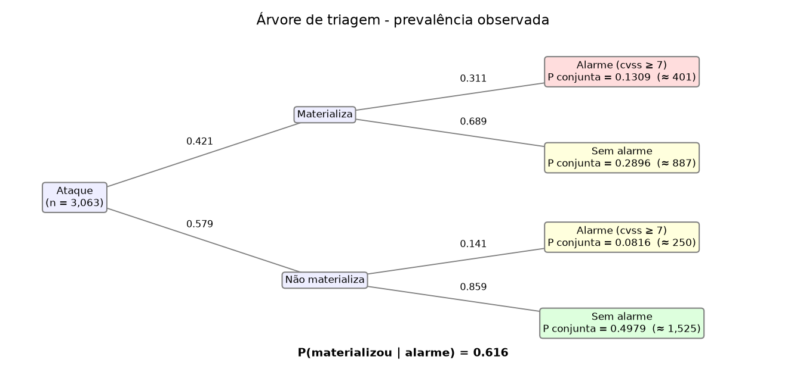

Se a prevalência caísse para 21,0% (por exemplo, com o pacote de controles), mantidas sensibilidade e especificidade, o valor preditivo do alarme cairia de 61,6% para **37,1%**: quase dois em cada três alarmes seriam falsos. Com prevalência de 5%, só 10%. É o efeito da taxa-base da Seção 3.8: o mesmo alarme vale menos quanto mais raro o evento. Uma consequência prática para a ANDI: se os controles funcionarem, a regra de triagem precisa ser recalibrada, ou a equipe passará a perseguir falsos alarmes.

### Questão 6 — Distribuições (cap. 4 e 5)

**a) Poisson.** Escolhemos a U06, a unidade sem SOC mais atacada (28 serviços, patch de 73%, 1,25 h de treino), com média de 5,94 ataques por mês. Pela Poisson, P(N ≥ 6) = 1 − F(5; 5,94) = **0,545**. Empiricamente, 21 dos 36 meses tiveram 6 ou mais ataques: **0,583**. A diferença (0,038) é menos da metade do erro padrão de uma proporção com n = 36 (0,083). O modelo descreve bem a unidade, que deve se preparar para 6 ou mais ataques em mais da metade dos meses. O mesmo acordo aparece nas outras dez unidades sem SOC (tabela `q06a_poisson`).

**b) Exponencial.** Para unidades com SOC e ataques em expediente (n = 976), o tempo médio observado é 3,88 h e o desvio 3,66 h (média ≈ desvio, como na Exponencial). A probabilidade teórica de passar de 8 h é e^(−8/3,88) = **0,127** com θ estimado (e e⁻² = 0,135 com θ = 4 do gerador). A proporção observada é **0,127**. Mesmo com SOC e em expediente, um em cada oito ataques leva mais de 8 h para ser detectado: a média de 4 h não é um teto.

**c) Q-Q de ln(perda) e escore Z.**

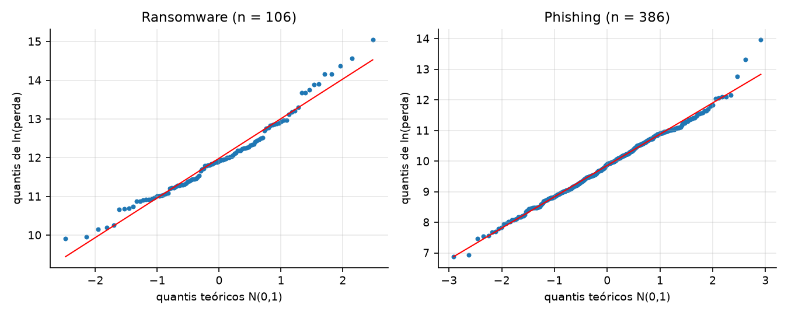

| | Ransomware | Phishing |
|---|---:|---:|
| n | 106 | 386 |
| Média / desvio de ln(perda) | 11,99 / 1,02 | 9,85 / 1,02 |
| Correlação do Q-Q | 0,987 | 0,996 |
| Shapiro-Wilk p | 0,032 | 0,132 |
| Assimetria de ln(perda) | 0,57 | 0,14 |
| Maior perda (R$) | 3.407.216 | 1.151.367 |
| Z da maior, em ln | 2,99 | 4,02 |
| Z da maior, em R$ | 6,65 | 15,40 |

Os pontos seguem a reta nos dois tipos; a hipótese Lognormal se sustenta como aproximação. No phishing, a normalidade de ln(perda) não é rejeitada. No ransomware é rejeitada por pouco (p = 0,032), com cauda direita um pouco acima da reta. Isso tem explicação no gerador: a perda é Lognormal *condicionada* ao tempo de detecção; sem condicionar, ln(perda) é Normal mais 0,02 × tempo, e o tempo é Exponencial, assimétrico à direita. A mistura tem cauda um pouco mais pesada que a Lognormal pura.

O escore Z mostra por que a escala importa. Em reais, a maior perda de phishing está a 15,4 desvios da média, o que seria impossível sob uma Normal. Em logaritmo está a 4,0 desvios: ainda rara (esperaríamos 0,01 caso assim em 386), e explicada pelo tempo de detecção de 120,8 h daquele ataque, que sozinho soma 2,4 ao logaritmo. A maior perda de ransomware (Z = 2,99 em ln) é rara, mas plausível em 106 observações.

### Questão 7 — Amostragem e estimação (cap. 6)

**a) IC de 95% para o tempo médio de detecção.**

| Grupo | n | Média (h) | IC 95% | θ programado | Contém θ? |
|---|---:|---:|---|---:|---|
| Com SOC, todos | 1.488 | 4,51 | [4,28; 4,75] | 4 | Não |
| Com SOC, só expediente | 976 | 3,88 | [3,65; 4,11] | 4 | Sim |
| Sem SOC, todos | 1.575 | 14,39 | [13,64; 15,14] | 12 | Não |
| Sem SOC, só expediente | 996 | 11,94 | [11,20; 12,68] | 12 | Sim |

Os intervalos com todos os ataques **não** contêm os θ programados, e isso não é erro de estimação. θ é a média da Exponencial antes do multiplicador de 1,5 aplicado aos 35% de ataques fora do expediente. A média populacional do tempo é θ × (0,65 + 0,35 × 1,5) = 1,175·θ: 4,70 h com SOC e 14,10 h sem. Os dois intervalos contêm esses valores. Restringindo aos ataques em expediente, os intervalos contêm 4 e 12. O IC estimou corretamente o parâmetro da população amostrada; a comparação ingênua é que mirava outro parâmetro.

**b) Proporção de materializados.** p̂ = 0,4205; IC 95% = 0,4205 ± 1,96·√(0,4205 × 0,5795 / 3.063) = **[0,403; 0,438]**. Para margem de ±2 p.p.: n = 1,96² × 0,4205 × 0,5795 / 0,02² = **2.341 ataques** (2.401 no caso conservador p = 0,5). A base atual, com 3.063, já entrega margem de ±1,75 p.p.

**c) Teorema Central do Limite.** A população é a própria base de perdas (μ = R$ 72.709; σ = R$ 171.283; assimetria 10,0). Em 2.000 amostras com reposição:

| | n = 5 | n = 30 | n = 100 |
|---|---:|---:|---:|
| Média das médias (R$) | 72.521 | 72.096 | 72.616 |
| Desvio das médias (R$) | 68.480 | 30.269 | 17.052 |
| σ/√n (R$) | 76.600 | 31.272 | 17.128 |
| Assimetria das médias | 3,31 | 1,60 | 0,94 |
| Curtose em excesso | 15,3 | 3,1 | 1,3 |

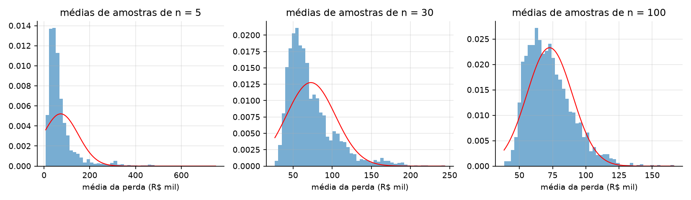

Duas previsões do TCL se confirmam: a média das médias fica em μ, e o desvio das médias segue σ/√n (razão de 0,97 em n = 30 e 1,00 em n = 100). A terceira, a forma Normal, chega devagar: em n = 30 a distribuição das médias ainda tem assimetria 1,6, e em n = 100 ainda 0,9. A regra prática "n ≥ 30" supõe uma população moderadamente assimétrica; com assimetria 10 e cauda pesada, uma única perda extrema domina a média de 30. Para a ANDI: intervalos de confiança para a perda média baseados em poucas dezenas de incidentes são otimistas no limite superior. Em ln(perda), a convergência seria imediata.

### Questão 8 — Testes de hipóteses e backtesting (cap. 7)

**a) Tempo médio de detecção com SOC (contrato: no máximo 4 h).**

1. H₀: μ ≤ 4 h (contrato cumprido); Hₐ: μ > 4 h.
2. Estatística t (σ desconhecido), n = 1.488.
3. α = 5%, unilateral à direita.
4. Rejeitar H₀ se t > t(0,05; 1.487) = 1,646.
5. x̄ = 4,514; s = 4,684; t = (4,514 − 4)/(4,684/√1.488) = **4,23**; p-valor = 1,2 × 10⁻⁵.
6. Rejeita-se H₀: o tempo médio de detecção nas unidades com SOC é maior que 4 h. O contrato não está sendo cumprido.

O resultado parece contradizer o gerador (θ = 4 h), mas não contradiz. O contrato fala do tempo médio de todos os ataques, e os 35% que chegam fora do expediente levam 50% mais tempo: a média verdadeira é 4,70 h. Repetindo o teste só com ataques em expediente, t = −1,03 (p = 0,85) e H₀ não é rejeitada. O SOC entrega 4 h no expediente e descumpre o contrato à noite e nos fins de semana. A ação é cobertura fora do expediente, e não trocar o SOC.

**b) Meta de no máximo 40% de materialização.**

1. H₀: p ≤ 0,40; Hₐ: p > 0,40.
2. Estatística Z para proporção.
3. α = 5%, unilateral à direita.
4. Rejeitar H₀ se z > 1,645.
5. p̂ = 0,4205; z = (0,4205 − 0,40)/√(0,40 × 0,60/3.063) = **2,32**; p-valor = 0,010.
6. Rejeita-se H₀: a proporção de ataques materializados supera a meta. A diferença é pequena (2 p.p.), mas estatisticamente clara com 3.063 ataques.

**c) Erros do item (a).** Erro Tipo I: concluir que o SOC descumpre o contrato (μ > 4 h) quando ele cumpre. Custo: disputa contratual indevida, multa ou troca de fornecedor sem motivo. Erro Tipo II: não rejeitar H₀ quando o tempo médio real passa de 4 h. Custo: a ANDI segue acreditando numa detecção mais rápida do que a real. Como cada hora de atraso aumenta a chance de materialização (razão de chances de 1,06 por hora, Questão 13) e encarece a perda em cerca de 2% (Questão 9), o **Tipo II é o mais caro**: é um risco que não aparece em nenhum relatório. Isso justificaria até um α maior neste teste, para ganhar poder.

**d) Backtesting do VaR (Kupiec).**

1. H₀: a proporção de exceções é 5% (modelo adequado); Hₐ: é diferente de 5%.
2. Estatística LR de Kupiec, qui-quadrado com 1 g.l.
3. α = 5%.
4. Rejeitar H₀ se LR > 3,84.
5. VaR de 95% estimado em 2023–2024 (576 unidades-mês): **R$ 365.992**. Em 2025 (T = 288), N = **17 exceções** (5,9%), contra 14,4 esperadas. LR = **0,47**; p-valor = 0,494.
6. Não se rejeita H₀: o VaR histórico de 2023–2024 não é rejeitado em 2025.

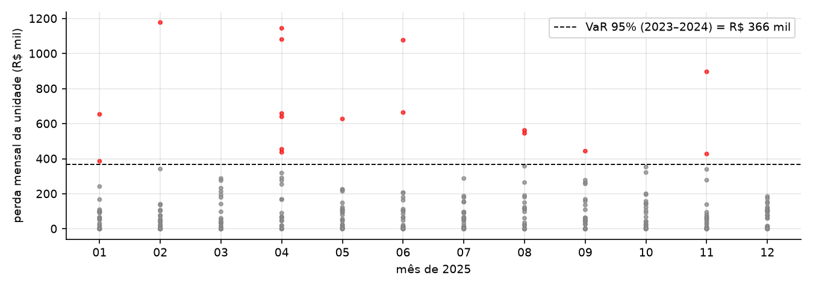

O modelo não foi rejeitado, embora saibamos que o gerador mudou entre os períodos (tendência de alta e campanha em abril de 2025). Três razões:

- A tendência é pequena diante do ruído. A taxa cresce 0,15 por trimestre sobre um nível próximo de 11; a perda média por unidade-mês foi de R$ 107,9 mil em 2023–2024 para R$ 109,4 mil em 2025.
- A campanha aparece, mas concentrada: abril de 2025 teve 6 exceções em 24 unidades (25%), contra 1,2 esperada. Kupiec só conta o total de exceções, e não vê que elas se agruparam num mês. Um teste de independência das exceções capturaria isso.
- Poder baixo: com T = 288 e p = 5%, o teste só rejeitaria com 23 ou mais exceções. Sem abril, são 11 em 264 (LR = 0,41).

Não rejeitar é diferente de validar. O teste de Kupiec deixou passar duas mudanças que sabemos existir.

### Questão 9 — Correlação e regressão simples (cap. 8)

**a) Dispersão e correlação.**

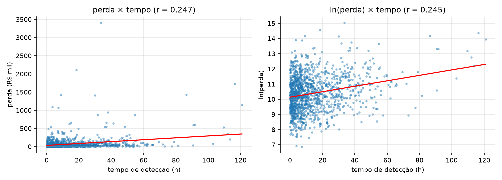

| | r | t (1.286 g.l.) | p-valor |
|---|---:|---:|---:|
| perda × tempo | 0,247 | 9,13 | < 0,0001 |
| ln(perda) × tempo | 0,245 | 9,06 | < 0,0001 |

Nos dois casos rejeita-se H₀: ρ = 0. A correlação é positiva e fraca. Os dois r são quase iguais, mas o diagrama em reais é dominado por poucos pontos extremos e tem variância crescente, enquanto em logaritmo a nuvem é homogênea em torno da reta. A escala logarítmica é a adequada para a regressão.

**b) Mínimos quadrados.** ln(perda) = **10,141 + 0,01796 · tempo** (erro padrão de β₁: 0,00198). Como a resposta está em logaritmo, β₁ é uma semielasticidade: cada hora a mais até a detecção aumenta a perda em e^0,01796 − 1 = **1,8%**; dez horas a mais, 19,7%. O intercepto corresponde a uma perda mediana de R$ 25,4 mil para detecção imediata (média dos tipos).

**c) R² e erro padrão.** R² = **0,060**; erro padrão da regressão = **1,155** (em ln). O tempo explica só 6% da variação de ln(perda). Isso não invalida a conclusão: R² mede quanto da dispersão o modelo explica, e não se o efeito existe. O efeito é estimado com precisão (t = 9,06; IC que exclui o zero) e tem relevância econômica. O R² baixo diz que o tempo não permite prever a perda de um incidente individual; o coeficiente diz que, em média, detectar mais rápido reduz a perda. A variável omitida que infla o resíduo é o **tipo de ataque**: a variância de ln(perda) é 1,418, e a variância entre as médias dos tipos é 0,484, um terço do total. Incluí-la (Questão 10-d) leva o R² a 0,42.

**d) Hipóteses de Gauss-Markov.**

- *Linearidade nos parâmetros:* plausível em logaritmo (não em reais).
- *Média zero do erro e exogeneidade:* é a hipótese mais frágil. O erro contém o tipo de ataque, mas tipo e tempo são sorteados de forma independente, o que mantém β₁ não viesado; só perde precisão.
- *Homocedasticidade:* plausível em ln (σ constante), violada em reais.
- *Erros não correlacionados:* plausível, pois os ataques são independentes.
- *Normalidade* (para a inferência exata): razoável em ln; com n = 1.288, o TCL sustenta os testes de qualquer modo.

O **viés de seleção** é o ponto de atenção: só observamos perdas de ataques que se materializaram, e o tempo de detecção influencia a materialização. A amostra de perdas tem tempos maiores que a população de ataques (média de 14,2 h nas perdas contra cerca de 9,6 h em todos os ataques). Se algum fator não observado afetasse ao mesmo tempo a materialização e a severidade, a seleção criaria correlação entre o erro e o tempo e enviesaria β₁. Neste gerador os dois sorteios são independentes dado o que observamos, e por isso a estimativa (0,018) fica perto do valor programado (0,02). Com dados reais, essa independência não estaria garantida. Além disso, a regressão descreve só ataques materializados: nada diz sobre o efeito do tempo na *chance* de haver perda, que é assunto da Questão 13.

### Questão 10 — Inferência na regressão (cap. 9)

**a) ANOVA.**

| Fonte | SQ | g.l. | QM | F |
|---|---:|---:|---:|---:|
| Regressão | 109,43 | 1 | 109,43 | 82,01 |
| Resíduo | 1.715,96 | 1.286 | 1,3343 | |
| Total | 1.825,39 | 1.287 | | |

F = 82,01, muito acima do crítico F(0,05; 1; 1.286) = 3,85. E t² = 9,0561² = 82,01 = F: na regressão simples, o teste F global e o teste t de β₁ são o mesmo teste. R² = 109,43/1.825,39 = 0,060.

**b) IC de 95% para β₁:** 0,01796 ± 1,962 × 0,00198 = **[0,0141; 0,0219]**. Contém o valor programado (0,02). Em termos percentuais, cada hora de atraso encarece a perda entre 1,4% e 2,2%.

**c) Ataque detectado em 24 h.**

| | ln(perda) | R$ |
|---|---:|---:|
| Estimativa pontual | 10,572 | 39.036 |
| IC 95% da média | [10,498; 10,646] | [36.257; 42.027] |
| Intervalo de previsão 95% (individual) | [8,305; 12,840] | [4.044; 376.846] |

O IC da média diz onde está a perda típica dos ataques detectados em 24 h: entre R$ 36 mil e R$ 42 mil (em reais, a exponencial da média de ln é a mediana, não a média). O intervalo de previsão diz onde cairá *uma* perda: entre R$ 4 mil e R$ 377 mil. O primeiro tem razão de 1,16 entre os extremos; o segundo, de 93. A diferença é que o IC da média só carrega a incerteza sobre a reta, que encolhe com 1/√n, enquanto o intervalo de previsão soma a variância do próprio incidente (s² = 1,33), que não encolhe com mais dados. Para a gestão: sabemos bem o custo médio do atraso, mas não é possível prever o custo de um incidente específico.

**d) Com dummies de tipo.**

| | Só tempo | Tempo + tipo |
|---|---:|---:|
| R² | 0,060 | 0,425 |
| R² ajustado | 0,059 | 0,422 |
| Erro padrão da regressão | 1,155 | 0,905 |
| β₁ | 0,01796 | 0,02142 |
| Erro padrão de β₁ | 0,00198 | 0,00157 |
| IC 95% de β₁ | [0,0141; 0,0219] | [0,0184; 0,0245] |

Controlar o tipo multiplica o R² por sete, reduz o erro padrão da regressão para **0,905** (o σ programado é 0,9) e estreita o IC de β₁ em 21%. Os dois intervalos contêm 0,02. As medianas implícitas por tipo (e^(β₀ + dummy), para tempo = 0) recuperam as programadas com razões entre 0,90 e 1,08, exceto ransomware (R$ 119 mil contra R$ 150 mil; razão 0,80), o tipo com menos observações (106) e maior erro padrão. É o capítulo 10 antecipado: a variável omitida não enviesava β₁, mas inflava o resíduo.

### Questão 11 — Regressão múltipla (cap. 10)

**a) Modelo base.**

| Variável | Coeficiente | Erro padrão | t | p-valor | IC 95% | Verdadeiro |
|---|---:|---:|---:|---:|---|---:|
| Intercepto | 5,533 | 2,871 | 1,93 | 0,055 | [−0,12; 11,18] | 8,00 |
| servicos | 0,454 | 0,034 | 13,46 | 0,000 | [0,39; 0,52] | 0,50 |
| patch | −0,037 | 0,033 | −1,12 | 0,265 | [−0,10; 0,03] | −0,08 |
| treino | −0,298 | 0,061 | −4,87 | 0,000 | [−0,42; −0,18] | −0,20 |
| soc | −1,798 | 0,434 | −4,14 | 0,000 | [−2,65; −0,94] | −1,40 |
| trimestre | 0,262 | 0,058 | 4,50 | 0,000 | [0,15; 0,38] | 0,15 |

**b) Testes e interpretação.** F = 54,0 (p ≈ 3 × 10⁻³⁹): o conjunto das variáveis é significativo. R² = 0,489; R² ajustado = 0,480; erro padrão = 3,41 ataques, para uma média de 10,6 por unidade-trimestre. O R² está longe do 0,97 do estudo de caso da Seção 10.7 porque aqui a resposta é uma contagem de Poisson: mesmo com a taxa verdadeira conhecida, a variância do ruído (≈ 10,7) é quase metade da variância total (22,3). Um R² próximo de 0,5 é o teto deste problema, e não sinal de modelo fraco.

Coeficientes parciais (mantidas as demais variáveis):

- **servicos (+0,45):** cada serviço exposto a mais acrescenta cerca de 0,45 ataque por trimestre. É a alavanca mais forte e mais precisa: reduzir a superfície de ataque.
- **treino (−0,30):** cada hora anual de conscientização evita 0,3 ataque por trimestre; levar uma unidade de 5 h para 12 h evita cerca de 2 por trimestre.
- **soc (−1,80):** unidades com SOC têm 1,8 ataque a menos por trimestre.
- **trimestre (+0,26):** a frequência cresce 0,26 ataque por trimestre em cada unidade, cerca de 1 por ano.
- **patch (−0,04):** sinal esperado, mas não significativo (p = 0,27). Com 24 unidades e patch variando só de 64% a 91%, a amostra não tem poder para isolar um efeito de −0,08. Não significa que patch seja inútil: o intervalo contém o valor verdadeiro.

**c) Estimado x verdadeiro.** Os **seis** intervalos de 95% contêm o valor programado. Isso é compatível com "95% de confiança": com seis intervalos, esperam-se 5,7 acertos, e a chance de todos acertarem é da ordem de 0,95⁶ ≈ 74%. Vale notar que o nível de confiança é uma propriedade do procedimento em amostras repetidas, e não de um intervalo específico; a simulação é o único contexto em que dá para conferir, porque a verdade é conhecida. As estimativas pontuais erram bastante em termos relativos (treino −0,30 contra −0,20, erro de 49%; trimestre 0,26 contra 0,15, erro de 74%), mas sempre dentro da incerteza declarada.

**d) Dummies de trimestre do ano e campanha (trimestre 10).**

| Variável | Coeficiente | Erro padrão | p-valor | Esperado pelo gerador |
|---|---:|---:|---:|---:|
| Q2 (vs. Q1) | −0,62 | 0,62 | 0,324 | +0,71 |
| Q3 (vs. Q1) | +0,24 | 0,57 | 0,668 | 0,00 |
| Q4 (vs. Q1) | +0,87 | 0,59 | 0,139 | +1,42 |
| campanha | +3,69 | 0,92 | 0,0001 | +3,28 |
| trimestre | 0,135 | 0,067 | 0,044 | 0,15 |

O ajuste melhora: R² ajustado sobe de 0,480 para 0,504, o AIC cai de 1.529,0 para 1.519,3 e o teste F parcial das quatro variáveis dá 4,42 (p = 0,002). O BIC piora (1.551,0 para 1.555,9), porque penaliza mais os parâmetros. Quase todo o ganho vem do indicador da **campanha**: 3,7 ataques a mais por unidade no trimestre, perto dos 3,3 esperados. As dummies sazonais não são significativas; a sazonalidade trimestral é fraca (os S_m dentro de um trimestre quase se cancelam) e Q2 saiu com sinal contrário ao esperado, dentro do erro. O efeito mais útil é indireto: com a campanha isolada, o coeficiente de **trimestre** cai de 0,262 para 0,135, bem mais perto do verdadeiro (0,15). No modelo base, a campanha no fim da amostra era lida como tendência. Por isso a Parte C usa este modelo, com campanha = 0 em 2026.

**e) VIF e resíduos.** Os VIF vão de 1,00 a 1,16: não há multicolinearidade.

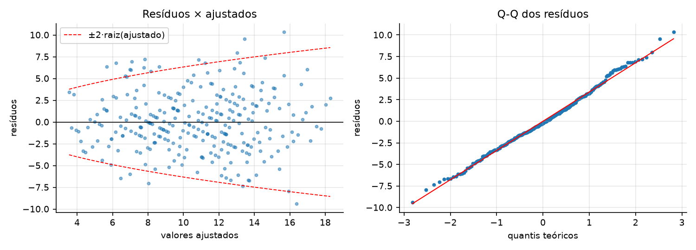

O Q-Q dos resíduos é aderente (Shapiro-Wilk p = 0,52). O gráfico de resíduos contra ajustados mostra o funil de forma moderada: a variância dos resíduos é 9,8 e 9,0 nos dois terços inferiores dos valores ajustados e 15,6 no terço superior. O Breusch-Pagan geral não rejeita a homocedasticidade (p = 0,11), mas a versão dirigida aos valores ajustados rejeita (p = 0,016), e a correlação de Spearman entre |resíduo| e ajustado é positiva (0,15; p = 0,010). O funil é esperado porque na Poisson a variância é igual à média: unidades com taxa prevista maior têm dispersão maior. É uma violação da homocedasticidade de Gauss-Markov que não enviesa os coeficientes, mas torna os erros padrão aproximados. A faixa de valores ajustados aqui é estreita (4 a 18), e por isso o funil não é dramático. O modelo adequado seria uma regressão de Poisson ou erros padrão robustos.

**f) Sobreajuste.**

| | Sem ruído | Com 5 ruídos |
|---|---:|---:|
| Parâmetros | 6 | 11 |
| R² de treino (2023–2024) | 0,4635 | 0,4670 |
| R² ajustado de treino | 0,4490 | 0,4375 |
| REQM de treino | 3,337 | 3,326 |
| REQM de teste (2025) | 3,499 | 3,547 |
| R² de teste | 0,470 | 0,455 |

O sintoma aparece, em escala pequena: as cinco variáveis de ruído aumentam o R² de treino (sempre aumentam) e pioram o erro de teste. O R² ajustado cai, sinalizando corretamente que não ajudam. O efeito é modesto porque há 192 observações de treino para 11 parâmetros; com poucas observações por parâmetro, seria como na Figura 10.8. Os dois modelos subestimam 2025 em cerca de 0,6 ataque por unidade-trimestre, por causa da campanha, que nenhum deles conhece.

### Questão 12 — Séries temporais (cap. 11, Parte A)

**a) Tendência e sazonalidade.**

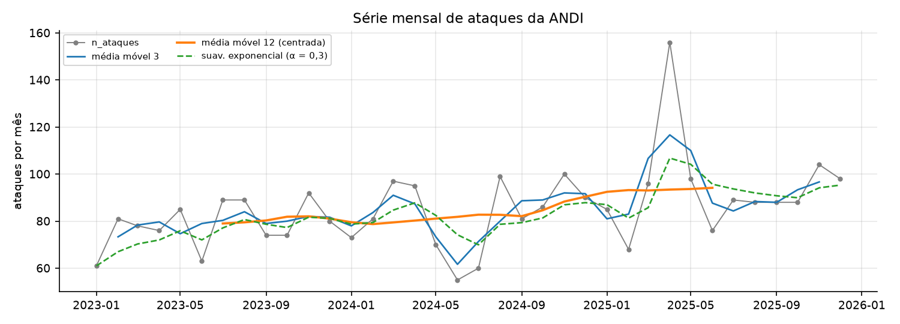

A média mensal foi de 78,5 ataques em 2023, 82,3 em 2024 e 94,5 em 2025 (88,9 sem abril). A média móvel de 12 meses mostra a tendência de alta com clareza; a reta de mínimos quadrados dá +0,68 ataque por mês (p = 0,012), acima dos +0,40 programados (0,15 por trimestre × 24 unidades ÷ 3 meses), porque a campanha no fim da série puxa a inclinação. A média móvel de 3 meses revela um padrão que se repete a cada ano, com picos em março–abril e novembro e vales em fevereiro e junho–julho, e destaca abril de 2025 (156 ataques). A suavização exponencial (α = 0,3) acompanha o nível com atraso; o α que minimiza o erro de previsão um passo à frente é 0,20, sinal de série ruidosa em que convém suavizar bastante.

**b) Decomposição.** Escolhemos a forma **multiplicativa** (Y = T × S × ε): em contagens, a amplitude sazonal cresce com o nível (o desvio dentro do ano subiu de 9,8 em 2023 para 15,2 em 2024), e a sazonalidade como percentual do nível é a leitura natural.

| Mês | Jan | Fev | Mar | Abr | Mai | Jun | Jul | Ago | Set | Out | Nov | Dez |
|---|---:|---:|---:|---:|---:|---:|---:|---:|---:|---:|---:|---:|
| Estimado | 0,91 | 0,87 | 1,11 | **1,41** | 0,94 | 0,73 | 0,91 | 1,14 | 0,94 | 0,95 | 1,11 | 0,98 |
| Programado | 0,90 | 0,85 | 1,10 | 1,10 | 1,00 | 0,95 | 0,90 | 0,95 | 1,00 | 1,05 | 1,15 | 1,05 |

Os índices acertam bem cinco meses (jan, fev, mar, jul, nov; erro até 0,04), mas a correlação com os S_m é só 0,62 e o erro absoluto médio é 0,09. Há dois problemas. A média móvel centrada perde 6 meses em cada ponta, e cada índice é a média de apenas dois anos. E abril está contaminado: o índice de 1,41 mistura a sazonalidade verdadeira (1,10) com a campanha de 2025. Como os índices são normalizados para média 1, o excesso de abril rebaixa os demais (junho: 0,73 contra 0,95). Três anos são pouco para estimar 12 índices.

**c) ACF.** O limite de significância é ±1,96/√36 = ±0,327. Nenhuma autocorrelação das defasagens 1 a 9, 11 e 12 o ultrapassa: r₁ = 0,26 e r₁₂ = 0,20 são positivos, como se espera com tendência e sazonalidade anual, mas não significativos. Só a defasagem 10 passa por pouco (−0,35), sem interpretação e compatível com acaso em 12 testes. A série é quase ruído em torno de uma tendência suave: os ataques de um mês pouco informam sobre o seguinte. Isso é coerente com contagens de Poisson independentes; a dependência temporal entra pela taxa, e não por contágio entre meses. A sazonalidade existe (amplitude de ±15%), mas é fraca frente ao ruído de uma contagem em torno de 85 (desvio de Poisson ≈ 9, ou 11%).

**d) Previsão de 2026 e regra dos 3σ.**

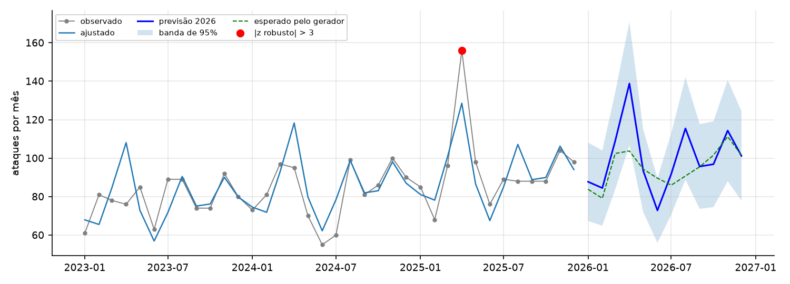

A previsão combina a tendência linear da série dessazonalizada com os índices sazonais; a banda de 95% vem do intervalo de previsão da reta e se alarga com o horizonte.

| 2026 | Jan | Fev | Mar | Abr | Mai | Jun | Jul | Ago | Set | Out | Nov | Dez | Total |
|---|---:|---:|---:|---:|---:|---:|---:|---:|---:|---:|---:|---:|---:|
| Previsão | 88 | 84 | 109 | 139 | 93 | 73 | 92 | 115 | 96 | 97 | 114 | 101 | 1.201 |
| Limite inferior | 67 | 65 | 84 | 107 | 72 | 56 | 71 | 89 | 74 | 74 | 88 | 78 | |
| Limite superior | 108 | 104 | 134 | 171 | 115 | 90 | 113 | 142 | 118 | 119 | 141 | 125 | |
| Esperado pelo gerador | 84 | 79 | 102 | 104 | 94 | 90 | 86 | 91 | 96 | 102 | 111 | 102 | 1.139 |

O total previsto (1.201) fica 5,4% acima do esperado pelo gerador (1.139), por causa da tendência superestimada. Mês a mês, o maior erro é abril (139 contra 104): o método projeta a campanha de 2025 como se fosse sazonalidade.

**Regra dos 3σ (método clássico).** Com σ dos resíduos = 11,5, o resíduo de abril de 2025 é +27,5, ou z = **2,39**. **O método não encontra a campanha.** Também não dispara falso alarme a 3σ. A 2σ, sinaliza os três abris: 2025 por excesso (+2,39) e 2023 e 2024 por falta (−2,79 e −2,03). É mascaramento: a anomalia entrou na estimativa do próprio índice de abril e inflou o σ, e então se esconde e faz os abris normais parecerem baixos.

**Complemento robusto.** Recalculamos os índices pela mediana dos três anos (razão à reta de tendência), e trocamos o σ estimado pelo desvio de Poisson, √(valor ajustado). O índice de abril cai para 1,13, o esperado para abril de 2025 passa a 103 e o z vai a **5,22**: a campanha é detectada, e é o único alarme (o segundo maior |z| é 2,30). A lição para um SOC é que um detector calibrado em dados que contêm a anomalia aprende a anomalia; a linha de base precisa ser robusta ou estimada em período limpo.

### Questão 13 — Classificação (cap. 11, Parte B)

Treino: 1.929 ataques de 2023–2024 (42,3% materializados). Teste: 1.134 ataques de 2025 (41,6%).

**a) Regressão logística.**

| Variável | β estimado | e^β | Erro padrão | IC 95% de β | β verdadeiro | e^β verdadeiro |
|---|---:|---:|---:|---|---:|---:|
| Intercepto | −2,753 | 0,064 | 0,242 | [−3,23; −2,28] | −2,80 | 0,061 |
| cvss | 0,431 | 1,539 | 0,035 | [0,36; 0,50] | 0,45 | 1,568 |
| tempo_deteccao_h | 0,057 | 1,059 | 0,006 | [0,045; 0,070] | 0,06 | 1,062 |
| soc | −0,767 | 0,465 | 0,115 | [−0,99; −0,54] | −0,80 | 0,449 |
| treino | −0,082 | 0,922 | 0,016 | [−0,11; −0,05] | −0,08 | 0,923 |
| fora_expediente | 0,637 | 1,890 | 0,110 | [0,42; 0,85] | 0,50 | 1,649 |

Todos os coeficientes são significativos (p < 0,001) e os seis intervalos contêm o valor programado. Em razões de chances: cada ponto de CVSS multiplica a chance de materialização por 1,54; cada hora de atraso na detecção, por 1,06 (uma demora de 12 h dobra a chance: 1,059¹² ≈ 2,0); ter SOC reduz a chance a menos da metade (0,46); cada hora de treinamento reduz 8%; um ataque fora do expediente tem chance 89% maior, além do efeito que já exerce pelo tempo de detecção. A recuperação dos parâmetros é melhor que na regressão de frequência porque aqui há 1.929 observações individuais, contra 24 perfis de unidade.

**b) Dummies de tipo.** Pelo gerador **não** deveriam ser significativas: o tipo não entra na equação da Etapa A4; ele só afeta a materialização por meio do CVSS, que já está no modelo. O teste de razão de verossimilhança das cinco dummies confirma: 9,01 com 5 g.l., p = 0,109, e o AIC piora (2.179,9 para 2.180,9). Uma dummy isolada, ransomware, aparece significativa (p = 0,017); com cinco testes a 5%, um falso positivo tem 23% de chance, e o teste conjunto é o correto. O contraste que ensina: sozinho, o tipo é fortemente associado à materialização (p ≈ 2 × 10⁻¹⁸), mas esse efeito desaparece ao controlar o CVSS. O tipo é um efeito mediado.

**c) Árvore de decisão (profundidade 3).**

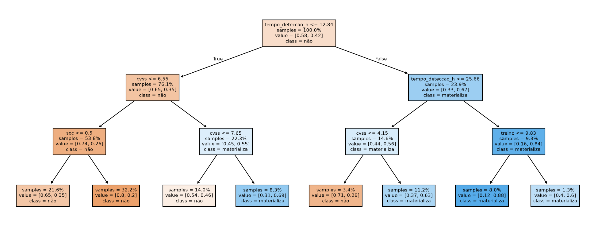

Regras (proporção de materializados no treino entre parênteses):

- Se tempo ≤ 12,8 h e cvss ≤ 6,55: **não materializa**; com SOC (20%), sem SOC (35%).
- Se tempo ≤ 12,8 h e 6,55 < cvss ≤ 7,65: **não materializa** (46%).
- Se tempo ≤ 12,8 h e cvss > 7,65: **materializa** (69%).
- Se 12,8 h < tempo ≤ 25,7 h e cvss ≤ 4,15: **não materializa** (29%).
- Se 12,8 h < tempo ≤ 25,7 h e cvss > 4,15: **materializa** (63%).
- Se tempo > 25,7 h: **materializa** (88% com treino ≤ 9,8 h; 60% acima).

A árvore usa tempo de detecção (importância 0,51) e CVSS (0,40), um pouco de SOC e treino, e ignora fora_expediente, cujo efeito já chega pelo tempo. As regras são legíveis para um analista: ataque que demora mais de um dia para ser detectado é perda quase certa.

**d) Avaliação em 2025 (limiar 0,5).**

| | Logística | Árvore |
|---|---:|---:|
| VP / FP / FN / VN | 279 / 140 / 193 / 522 | 227 / 104 / 245 / 558 |
| Acurácia | 0,706 | 0,692 |
| Precisão | 0,666 | 0,686 |
| Recall | 0,591 | 0,481 |
| F1 | 0,626 | 0,565 |
| AUC | 0,773 | 0,732 |

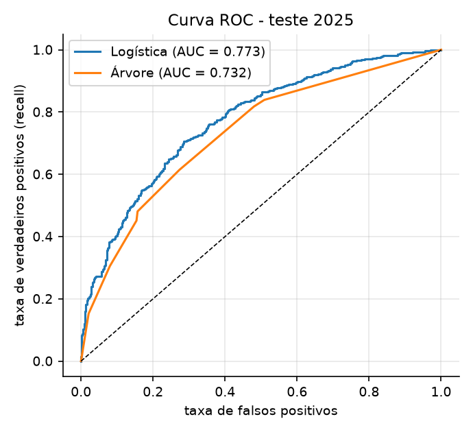

A logística vence em quase tudo, o que é esperado: o gerador é exatamente um modelo logístico, e a árvore aproxima uma fronteira linear com degraus. A árvore tem precisão um pouco maior, à custa de deixar passar mais da metade das perdas (recall de 0,48). Uma AUC de 0,77 é o limite do problema, não do modelo: a materialização é um sorteio de Bernoulli, e nem o modelo verdadeiro passaria muito disso. O desempenho em 2025 é parecido com o do treino: não há sinal de mudança de conceito na materialização (a campanha alterou a frequência, não a probabilidade).

**e) Limiar de custo mínimo.** Falso negativo: R$ 30.599 (perda mediana em 2023–2024); falso positivo: R$ 3.000. O limiar teórico é c_FP/(c_FP + c_FN) = **0,089**: vale alarmar sempre que a probabilidade de perda passar de 9%.

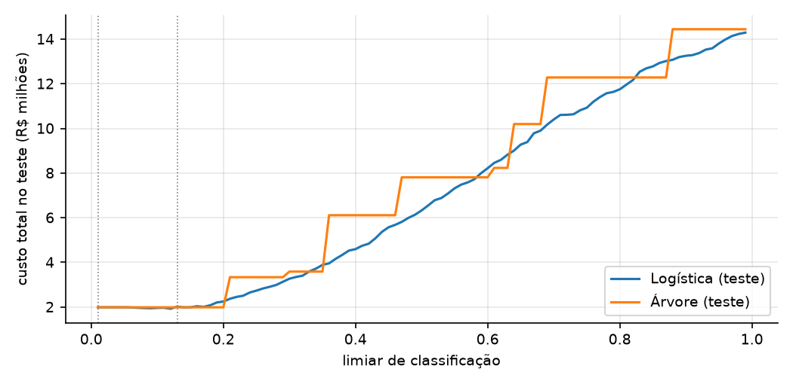

| Logística | Limiar 0,5 | Limiar 0,13 (escolhido no treino) |
|---|---:|---:|
| FP / FN | 140 / 193 | 580 / 9 |
| Recall | 0,591 | 0,981 |
| Precisão | 0,666 | 0,444 |
| Custo no teste | R$ 6,33 mi | R$ 2,02 mi |

Baixar o limiar de 0,5 para 0,13 corta o custo em 68%: troca 184 falsos negativos (R$ 5,6 mi) por 440 falsos positivos (R$ 1,3 mi). É a tensão α × β do capítulo 7: o limiar é a fronteira da região de rejeição; baixá-lo aumenta α (falsos alarmes) e reduz β (perdas não vistas). Como o erro Tipo II custa dez vezes mais, o ótimo aceita muito mais Tipo I. O limiar 0,5 só é ótimo quando os dois erros custam o mesmo.

Um resultado que precisa ser dito: com esses custos, **investigar todos os ataques custaria R$ 1,99 mi**, um pouco menos que o melhor limiar da logística (R$ 2,02 mi); e o limiar ótimo da árvore é "alarmar tudo". Com prevalência de 42% e razão de custos de 10 para 1, quase nenhum ataque tem probabilidade abaixo de 9%, e a triagem pouco agrega. O classificador passaria a valer com investigação mais cara, prevalência menor (como no cenário com controles) ou capacidade limitada de analistas, caso em que serviria para ordenar a fila.

---

## Parte C — SMC de risco e decisão

### Questão 14 — Perda anual de 2026 e o pacote de controles

**a) Modelar.** A perda anual agregada é

L = Σ_u Σ_k Σ_{j=1..N_{u,k}} X_{u,k,j}, com N_{u,k} ~ Poisson(λ_u · π_k · p_{u,k}) e X ~ Lognormal(μ_{k,s}, σ_k),

em que u é a unidade, k o tipo de ataque e s o status de SOC da unidade. Nenhum parâmetro do gerador é usado; cada insumo vem da Parte B:

- **Frequência λ_u (Questão 11).** Soma das previsões dos trimestres 13 a 16 para o perfil da unidade, pelo modelo 11-d com campanha = 0. Escolhemos o 11-d porque ele separa a campanha da tendência; o modelo base preveria 1.222 ataques em 2026, e o 11-d prevê **1.095** (em 2025 foram 1.134, incluindo a campanha).
- **Participação dos tipos π_k.** Frequências relativas observadas.
- **Materialização p_{u,k} (Questão 13).** Média da probabilidade prevista pela logística para ataques do tipo k, com o SOC e o treino da unidade. CVSS e fora_expediente vêm dos ataques observados daquele tipo; o tempo de detecção vem dos ataques observados em unidades com o mesmo status de SOC.
- **Severidade (perdas.csv).** Lognormal por tipo. Os parâmetros diretos (média e desvio de ln perda) estão abaixo. Para o efeito do SOC, estimamos ln(perda) = μ_k + δ·soc: **δ = −0,248** (erro padrão 0,057; p ≈ 2 × 10⁻⁵), ou seja, perdas 22% menores em unidades com SOC.

| Tipo | n | μ̂ | σ̂ | Mediana e^μ̂ (R$) | Média implícita (R$) | Média amostral (R$) |
|---|---:|---:|---:|---:|---:|---:|
| Phishing | 386 | 9,855 | 1,021 | 19.047 | 32.081 | 34.144 |
| Força bruta | 193 | 9,536 | 0,896 | 13.847 | 20.677 | 20.529 |
| Malware | 220 | 10,588 | 0,926 | 39.660 | 60.878 | 62.053 |
| Exploração de vuln. | 245 | 10,998 | 0,969 | 59.757 | 95.537 | 97.260 |
| DDoS | 138 | 10,513 | 0,940 | 36.802 | 57.266 | 56.124 |
| Ransomware | 106 | 11,985 | 1,022 | 160.370 | 270.392 | 295.111 |

**Thinning.** Se os ataques chegam como Poisson de taxa λ e cada um, de forma independente, é do tipo k com probabilidade π_k e se materializa com probabilidade p, então os eventos de perda de cada tipo são Poisson de taxa λ·π_k·p, independentes entre si. Isso permite sortear direto o número de perdas, sem simular os ataques que não geram perda. A hipótese exigida é que a materialização de um ataque não dependa da dos outros. Usar a probabilidade *média* é exato para a contagem (uma mistura de Bernoullis independentes tem média p̄), desde que a severidade seja sorteada da distribuição das perdas, como fazemos.

Insumos agregados:

| | Atual | Com controles | Variação |
|---|---:|---:|---:|
| Ataques por ano (Σλ) | 1.094,8 | 757,6 | −30,8% |
| Probabilidade média de materialização | 0,424 | 0,194 | −54,3% |
| Eventos de perda por ano | 464,1 | 146,7 | −68,4% |
| Severidade média (R$) | 67.742 | 64.210 | −5,2% |
| Perda anual esperada, analítica (R$ mi) | 31,44 | 9,42 | −70,0% |

Coerência com o histórico: de 2023 a 2025 houve 429 perdas e R$ 31,2 mi por ano, em média.

**b) Sortear, calcular, analisar (100.000 réplicas).**

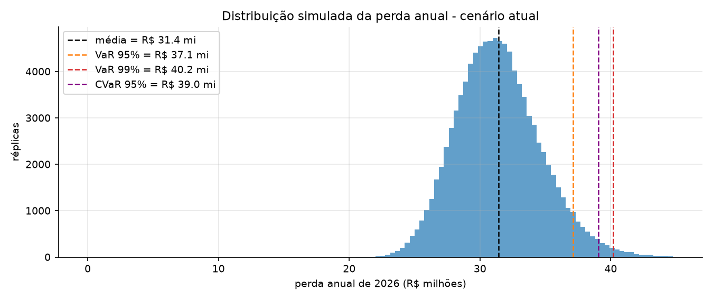

| Métrica | Cenário atual | Interpretação |
|---|---:|---|
| Perda média anual | R$ 31,43 mi | Expectativa de perda em 2026 |
| Mediana | R$ 31,23 mi | Valor central |
| Desvio-padrão | R$ 3,27 mi | Variação de um ano para outro |
| VaR 95% | R$ 37,11 mi | Só superada em 5% dos anos |
| VaR 99% | R$ 40,19 mi | Só superada em 1% dos anos |
| CVaR 95% | R$ 39,05 mi | Perda média nos 5% piores anos |
| P(perda > R$ 30 mi) | 65,3% | Probabilidade de perda relevante |

A ANDI deve esperar perder cerca de R$ 31 mi em 2026, com 5% de chance de passar de R$ 37 mi; nos piores anos, a perda média seria de R$ 39 mi. A distribuição anual é bem menos assimétrica que a de uma perda individual: é a soma de cerca de 460 eventos, e o TCL atua. Mesmo assim a cauda direita é mais longa (o VaR 99% está 2,7 desvios acima da média, contra 2,33 numa Normal).

**c) Convergência.**

| n | Média (R$ mi) | Erro padrão (R$ mi) | VaR 95% (R$ mi) | EP relativo ao de n = 1.000 | 1/√(n/1.000) |
|---:|---:|---:|---:|---:|---:|
| 1.000 | 31,512 | 0,1098 | 37,502 | 1,000 | 1,000 |
| 4.000 | 31,413 | 0,0526 | 37,291 | 0,479 | 0,500 |
| 16.000 | 31,458 | 0,0261 | 37,217 | 0,238 | 0,250 |
| 64.000 | 31,435 | 0,0129 | 37,115 | 0,118 | 0,125 |
| 100.000 | 31,433 | 0,0103 | 37,112 | 0,094 | 0,100 |

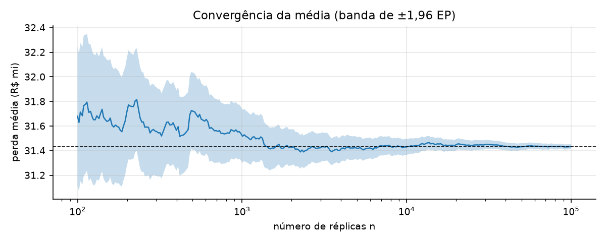

O erro padrão cai na proporção 1/√n: cada vez que n quadruplica, o erro cai à metade (0,110 → 0,053 → 0,026 → 0,013). Com 100.000 réplicas, a média tem erro de R$ 10 mil (0,03%). O VaR 95% estabiliza mais devagar, porque depende só das réplicas de cauda; a partir de 64.000 muda na quarta casa. O erro de simulação é desprezível diante do erro de modelo medido no item (g).

**d) Cenário com controles.** Patch = 95%, treino = 12 h e SOC em todas as unidades, realimentando os três modelos:

- *Frequência:* a regressão 11-d prevê 757,6 ataques (−31%).
- *Materialização:* a logística recebe soc = 1 e treino = 12, e o tempo de detecção de cada ataque passa a ser sorteado dos tempos observados em unidades com SOC. A probabilidade média cai de 0,424 para 0,194.
- *Severidade:* como o SOC reduz o tempo de detecção e cada hora encarece a perda, as unidades que ganham SOC passam a usar μ_k + δ (perdas 22% menores). O valor de δ é coerente com o caminho alternativo: β₁ × diferença de tempo médio entre perdas com e sem SOC = 0,0214 × (5,72 − 18,38) = −0,271.

| Métrica | Atual | Com controles | Redução |
|---|---:|---:|---:|
| Perda média anual | R$ 31,43 mi | R$ 9,42 mi | R$ 22,02 mi (70%) |
| Mediana | R$ 31,23 mi | R$ 9,24 mi | R$ 21,99 mi (70%) |
| VaR 95% | R$ 37,11 mi | R$ 12,48 mi | R$ 24,64 mi (66%) |
| VaR 99% | R$ 40,19 mi | R$ 14,36 mi | R$ 25,83 mi (64%) |
| CVaR 95% | R$ 39,05 mi | R$ 13,66 mi | R$ 25,39 mi (65%) |
| P(perda > R$ 30 mi) | 65,3% | 0,0% | −65,3 p.p. |

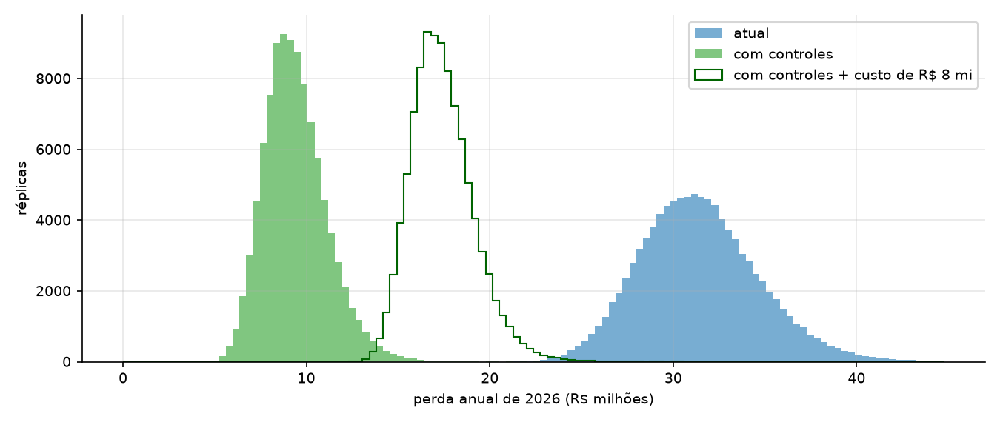

**e) Decisão.**

- Redução da perda média: R$ 22,02 mi por ano (erro padrão de simulação: R$ 0,007 mi).
- **ROI = (22,02 − 8,00)/8,00 = 175%.** Benefício líquido médio: R$ 14,0 mi por ano.
- P(perda com controles + R$ 8 mi > perda sem controles) = **0,00%** em 100.000 réplicas pareadas com números aleatórios comuns: mesmo somando o custo, a distribuição com controles fica inteira à esquerda da atual.
- Custo máximo que ainda se paga na média: **R$ 22,0 mi por ano**.

Os números aleatórios comuns usam o mesmo U para a contagem de Poisson e o mesmo z para a severidade de cada evento nos dois cenários. A diferença entre cenários fica livre do ruído comum, e por isso o erro padrão da redução (R$ 0,007 mi) é menor que o da própria média (R$ 0,010 mi).

**f) Sensibilidade.**

| σ da Lognormal | Frequência | Perda média atual (R$ mi) | Redução (R$ mi) | Benefício líquido (R$ mi) | ROI | Decisão |
|---|---|---:|---:|---:|---:|---|
| −20% | −10% | 23,85 | 16,72 | 8,72 | 109% | investir |
| −20% | base | 26,51 | 18,58 | 10,58 | 132% | investir |
| −20% | +10% | 29,15 | 20,42 | 12,42 | 155% | investir |
| base | −10% | 28,28 | 19,81 | 11,81 | 148% | investir |
| base | base | 31,43 | 22,02 | 14,02 | 175% | investir |
| base | +10% | 34,55 | 24,20 | 16,20 | 203% | investir |
| +20% | −10% | 34,84 | 24,39 | 16,39 | 205% | investir |
| +20% | base | 38,71 | 27,11 | 19,11 | 239% | investir |
| +20% | +10% | 42,55 | 29,79 | 21,79 | 272% | investir |

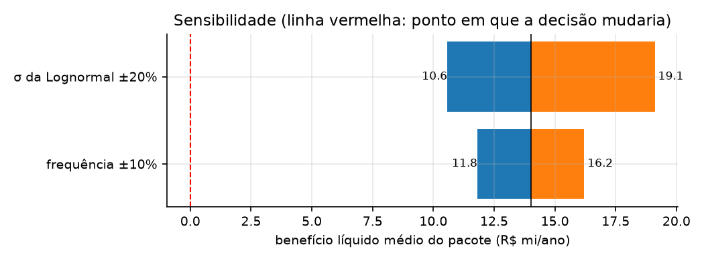

**A decisão não muda em nenhum dos nove casos.** No pior (σ 20% menor e frequência 10% menor), o ROI ainda é 109%. O σ pesa mais que a frequência: ±20% em σ move o benefício líquido entre R$ 10,6 mi e R$ 19,1 mi, contra R$ 11,8 mi a R$ 16,2 mi para ±10% na frequência, porque σ entra no expoente da média da Lognormal (e^(μ + σ²/2)). Para a decisão se inverter, a redução de perda teria de cair de R$ 22 mi para menos de R$ 8 mi, uma queda de 64%.

**g) Erro de modelo.** Rodamos o gerador da Parte A com os parâmetros verdadeiros para 2026 (t = 37 a 48, sem campanha) em 10.000 anos.

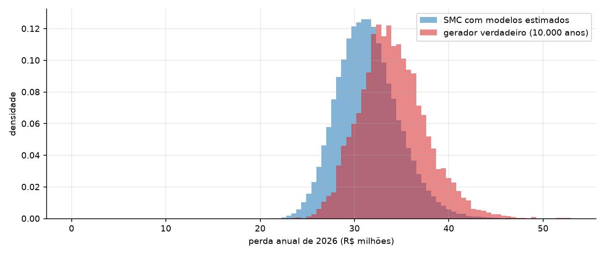

| Métrica (R$ mi) | SMC estimada (b) | Gerador verdadeiro | Erro |
|---|---:|---:|---:|
| Média | 31,43 | 34,12 | −7,9% |
| Mediana | 31,23 | 33,81 | −7,6% |
| Desvio-padrão | 3,27 | 3,66 | −10,7% |
| VaR 95% | 37,11 | 40,39 | −8,1% |
| VaR 99% | 40,19 | 44,09 | −8,8% |
| CVaR 95% | 39,05 | 42,92 | −9,0% |
| CVaR 99% | 42,15 | 47,78 | −11,8% |
| P99,9 | 44,76 | 52,96 | −15,5% |
| P(perda > R$ 30 mi) | 65,3% | 88,1% | −22,8 p.p. |

A SMC baseada em modelos estimados **subestima** a distribuição inteira, e o erro cresce em direção à cauda: −8% na média, −9% no VaR 99%, −12% no CVaR 99%, −15% no percentil 99,9. O erro padrão da média verdadeira é R$ 0,04 mi, portanto a diferença de R$ 2,7 mi não é ruído de simulação. Decomposição:

| Componente | Estimado | Verdadeiro | Erro |
|---|---:|---:|---:|
| Ataques por ano | 1.094,8 | 1.140,0 | −4,0% |
| Probabilidade de materialização | 0,424 | 0,426 | −0,6% |
| Severidade média (R$) | 67.742 | 70.209 | −3,5% |

- **Frequência (−4%).** É erro de estimação da regressão, com 24 unidades e muito ruído de Poisson. Vale notar que é sorte de amostra: o modelo base erraria +7%, para o outro lado.
- **Materialização (−0,6%).** A logística, estimada com quase 2.000 ataques, praticamente acerta.
- **Severidade (−3,5% na média, mais na cauda).** É erro de especificação. A Lognormal por tipo ignora que a perda verdadeira é Lognormal *condicionada ao tempo de detecção*. O tempo é Exponencial, e e^(0,02 × tempo) tem cauda mais pesada que a de uma Lognormal. O ajuste por tipo acerta o centro e perde a ponta, e é por isso que o erro cresce na cauda.

Há ainda um motivo estrutural para a cauda ser subestimada: a SMC trata os parâmetros estimados como certos. A incerteza sobre os coeficientes não entra na dispersão simulada.

A decisão sobrevive ao erro: com os parâmetros verdadeiros, a redução da perda média é de R$ 23,3 mi e o ROI é de 192%, contra R$ 22,0 mi e 175% estimados. O modelo errou o nível em cerca de 8%, para menos nos dois cenários, e acertou a diferença entre eles.

---

## Síntese

1. O gerador reproduz o que foi programado; as diferenças observadas têm o tamanho do erro de simulação σ/√n.
2. A perda por incidente é aproximadamente Lognormal: mediana de R$ 32 mil, média de R$ 73 mil, e 10% dos incidentes respondem por 52% do valor.
3. Com 3.063 ataques, os modelos recuperam os parâmetros dentro dos intervalos de confiança; a precisão é boa onde há muitas observações (logística) e fraca onde há poucas (24 perfis de unidade).
4. Três métodos falharam de modo instrutivo: o backtesting de Kupiec não rejeitou um modelo que sabemos desatualizado; a regra dos 3σ não achou a campanha por mascaramento; a triagem por classificador quase não reduz custo com a prevalência atual.
5. A SMC de decisão estima perda de R$ 31,4 mi em 2026 (VaR 95% de R$ 37,1 mi) e recomenda o pacote (ROI de 175%). Ela subestima a perda verdadeira em cerca de 8%, mais na cauda, sem alterar a decisão.
