# Resultados - grupo 5 (semente 202605)

Arquivo gerado automaticamente por `main.py`. Não editar à mão.

## Questão 1 - Implementação do gerador

- `q1.semente` = 202605
- `q1.linhas_unidades` = 24
- `q1.linhas_ataques` = 3063
- `q1.linhas_perdas` = 1288
- `q1.linhas_painel_trimestral` = 288
- `q1.linhas_serie_mensal` = 36

**Tabela `q01_unidades`** Perfil sorteado das 24 unidades (Etapa A1).

| unidade   |   servicos |   patch |   treino |   soc |
|:----------|-----------:|--------:|---------:|------:|
| U01       |      16.00 |   78.17 |     5.20 |  1.00 |
| U02       |      16.00 |   75.02 |     1.69 |  1.00 |
| U03       |      28.00 |   64.19 |     9.39 |  1.00 |
| U04       |      28.00 |   84.94 |     4.36 |  1.00 |
| U05       |      21.00 |   82.53 |     3.96 |  0.00 |
| U06       |      28.00 |   73.42 |     1.25 |  0.00 |
| U07       |      12.00 |   81.03 |     9.68 |  1.00 |
| U08       |      19.00 |   86.24 |    10.26 |  0.00 |
| U09       |      24.00 |   72.42 |     3.88 |  1.00 |
| U10       |      11.00 |   86.00 |     1.30 |  1.00 |
| U11       |      16.00 |   68.63 |     6.51 |  1.00 |
| U12       |      27.00 |   90.70 |     8.73 |  0.00 |
| U13       |      14.00 |   69.60 |     0.11 |  0.00 |
| U14       |      27.00 |   74.92 |     0.52 |  1.00 |
| U15       |      27.00 |   76.04 |     3.12 |  0.00 |
| U16       |      20.00 |   74.50 |     3.66 |  0.00 |
| U17       |      11.00 |   85.63 |     3.53 |  0.00 |
| U18       |      24.00 |   77.79 |     3.95 |  1.00 |
| U19       |      14.00 |   79.91 |     1.18 |  1.00 |
| U20       |      21.00 |   81.02 |     8.48 |  0.00 |
| U21       |      23.00 |   77.34 |    10.73 |  0.00 |
| U22       |      13.00 |   72.02 |     6.99 |  1.00 |
| U23       |      14.00 |   81.74 |     5.88 |  0.00 |
| U24       |      11.00 |   70.13 |     9.09 |  1.00 |


### 1-b) Transformação inversa própria x biblioteca


**Tabela `q01b_inversa`** Comparação com n = 200,000 sorteios (mesmo U para a própria e a ppf do SciPy).

|                           |   Triangular(60; 80; 95) |   Exponencial(θ = 4 h) |   Exponencial(θ = 12 h) |
|:--------------------------|-------------------------:|-----------------------:|------------------------:|
| média teórica             |                 78.33333 |                4.00000 |                12.00000 |
| média F⁻¹ própria         |                 78.35196 |                4.01000 |                12.02999 |
| média biblioteca          |                 78.31123 |                3.99635 |                12.02715 |
| dp teórico                |                  7.16860 |                4.00000 |                12.00000 |
| dp F⁻¹ própria            |                  7.16669 |                4.01007 |                12.03021 |
| dp biblioteca             |                  7.16068 |                4.00257 |                11.99598 |
| máx |própria − ppf SciPy| |                  0.00000 |                0.00000 |                 0.00000 |
| KS p-valor (própria)      |                  0.30826 |                0.30826 |                 0.30826 |
| KS p-valor (biblioteca)   |                  0.00919 |                0.49315 |                 0.31782 |


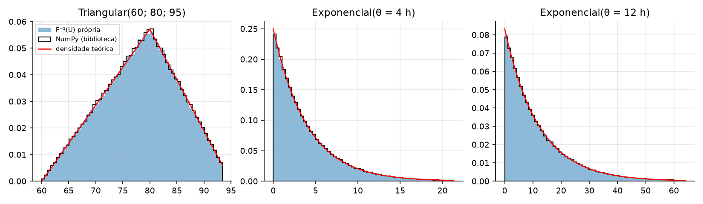
*Figura `q01b_inversa`* Transformação inversa própria, função pronta e densidade teórica.


## Questão 2 - Verificação do gerador


### 2-a) Média mensal de ataques: observada x teórica


**Tabela `q02a_media_unidade`** Erro padrão = raiz(λ̄/36); |z| > 1,96 seria atípico.

| unidade   |   soc |   média teórica |   média observada |   diferença |   erro padrão |      z |
|:----------|------:|----------------:|------------------:|------------:|--------------:|-------:|
| U01       | 1.000 |           2.834 |             2.944 |       0.110 |         0.281 |  0.393 |
| U02       | 1.000 |           3.160 |             3.250 |       0.090 |         0.296 |  0.304 |
| U03       | 1.000 |           4.979 |             4.000 |      -0.979 |         0.372 | -2.632 |
| U04       | 1.000 |           4.756 |             4.861 |       0.105 |         0.363 |  0.290 |
| U05       | 0.000 |           4.132 |             4.083 |      -0.048 |         0.339 | -0.143 |
| U06       | 0.000 |           5.761 |             5.944 |       0.184 |         0.400 |  0.459 |
| U07       | 1.000 |           1.767 |             1.528 |      -0.239 |         0.222 | -1.081 |
| U08       | 0.000 |           3.259 |             2.917 |      -0.342 |         0.301 | -1.136 |
| U09       | 1.000 |           4.447 |             4.472 |       0.025 |         0.351 |  0.070 |
| U10       | 1.000 |           2.033 |             1.944 |      -0.089 |         0.238 | -0.373 |
| U11       | 1.000 |           3.005 |             2.889 |      -0.117 |         0.289 | -0.403 |
| U12       | 0.000 |           4.607 |             4.750 |       0.143 |         0.358 |  0.399 |
| U13       | 0.000 |           3.553 |             3.639 |       0.086 |         0.314 |  0.275 |
| U14       | 1.000 |           5.121 |             4.889 |      -0.232 |         0.377 | -0.615 |
| U15       | 0.000 |           5.391 |             4.806 |      -0.585 |         0.387 | -1.512 |
| U16       | 0.000 |           4.201 |             4.028 |      -0.173 |         0.342 | -0.506 |
| U17       | 0.000 |           2.369 |             2.944 |       0.576 |         0.257 |  2.244 |
| U18       | 1.000 |           4.296 |             3.611 |      -0.685 |         0.345 | -1.983 |
| U19       | 1.000 |           2.720 |             2.611 |      -0.109 |         0.275 | -0.396 |
| U20       | 0.000 |           3.864 |             3.861 |      -0.003 |         0.328 | -0.009 |
| U21       | 0.000 |           4.153 |             3.944 |      -0.208 |         0.340 | -0.613 |
| U22       | 1.000 |           2.368 |             2.917 |       0.549 |         0.256 |  2.140 |
| U23       | 0.000 |           2.827 |             2.833 |       0.006 |         0.280 |  0.023 |
| U24       | 1.000 |           1.935 |             1.417 |      -0.518 |         0.232 | -2.234 |

- `q2a.unidades_fora_2ep` = 5
- `q2a.soma_z2` = 32.4811
- `q2a.soma_z2_pvalor` = 0.1155
- `q2a.total_observado` = 3063
- `q2a.total_teorico` = 3151.3
- `q2a.z_total` = -1.573

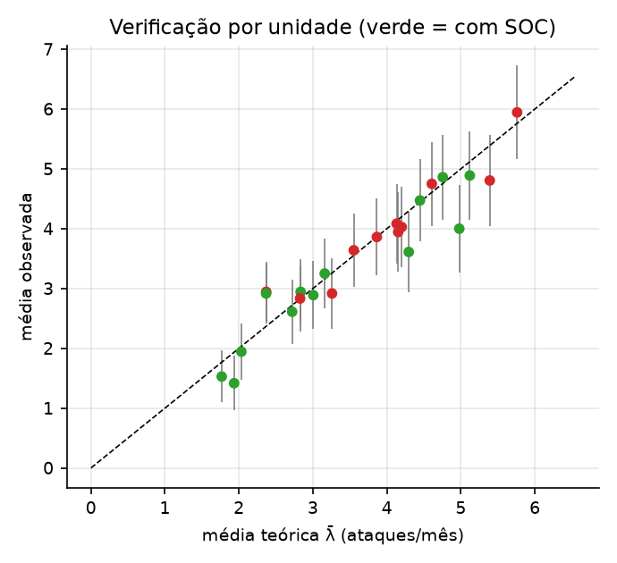
*Figura `q02a_media_unidade`* Média mensal observada x teórica, com banda de ±1,96 EP.


### 2-b) Variância x média (Poisson) e heterogeneidade


**Tabela `q02b_dispersao_unidade`** Índice de dispersão por unidade (36 meses cada).

| unidade   |   soc |   média |   variância |   var. teórica (λ̄ + Var λ_t) |   variância/média |
|:----------|------:|--------:|------------:|------------------------------:|------------------:|
| U01       | 1.000 |   2.944 |       2.854 |                         3.183 |             0.969 |
| U02       | 1.000 |   3.250 |       4.307 |                         3.578 |             1.325 |
| U03       | 1.000 |   4.000 |       5.600 |                         5.910 |             1.400 |
| U04       | 1.000 |   4.861 |       5.837 |                         5.612 |             1.201 |
| U05       | 0.000 |   4.083 |       4.479 |                         4.797 |             1.097 |
| U06       | 0.000 |   5.944 |       6.454 |                         6.978 |             1.086 |
| U07       | 1.000 |   1.528 |       1.571 |                         1.936 |             1.028 |
| U08       | 0.000 |   2.917 |       3.221 |                         3.699 |             1.104 |
| U09       | 1.000 |   4.472 |       5.628 |                         5.207 |             1.258 |
| U10       | 1.000 |   1.944 |       4.168 |                         2.240 |             2.144 |
| U11       | 1.000 |   2.889 |       1.930 |                         3.390 |             0.668 |
| U12       | 0.000 |   4.750 |       6.479 |                         5.416 |             1.364 |
| U13       | 0.000 |   3.639 |       3.037 |                         4.063 |             0.835 |
| U14       | 1.000 |   4.889 |       5.587 |                         6.101 |             1.143 |
| U15       | 0.000 |   4.806 |       4.275 |                         6.467 |             0.890 |
| U16       | 0.000 |   4.028 |       3.571 |                         4.886 |             0.887 |
| U17       | 0.000 |   2.944 |       2.397 |                         2.630 |             0.814 |
| U18       | 1.000 |   3.611 |       5.044 |                         5.009 |             1.397 |
| U19       | 1.000 |   2.611 |       1.730 |                         3.046 |             0.663 |
| U20       | 0.000 |   3.861 |       3.609 |                         4.456 |             0.935 |
| U21       | 0.000 |   3.944 |       3.597 |                         4.824 |             0.912 |
| U22       | 1.000 |   2.917 |       3.050 |                         2.629 |             1.046 |
| U23       | 0.000 |   2.833 |       3.743 |                         3.174 |             1.321 |
| U24       | 1.000 |   1.417 |       1.393 |                         2.127 |             0.983 |

- `q2b.indice_medio_sem_soc` = 1.0221
- `q2b.indice_min_sem_soc` = 0.8140
- `q2b.indice_max_sem_soc` = 1.3639
- `q2b.media_todas` = 3.5451
- `q2b.variancia_todas` = 4.9945
- `q2b.indice_todas` = 1.4088
- `q2b.var_dentro_media` = 3.8984
- `q2b.var_entre_medias` = 1.1986

### 2-c) Frequências dos tipos e taxa de materialização


**Tabela `q02c_tipos`** n = 3,063 ataques; erro = raiz(p(1−p)/n).

|                               |   prob. programada |   frequência |   freq. relativa |   diferença |   erro de simulação |       z |
|:------------------------------|-------------------:|-------------:|-----------------:|------------:|--------------------:|--------:|
| Phishing                      |             0.3500 |   1,031.0000 |           0.3366 |     -0.0134 |              0.0086 | -1.5551 |
| Força bruta                   |             0.2000 |     625.0000 |           0.2040 |      0.0040 |              0.0072 |  0.5601 |
| Malware                       |             0.1500 |     493.0000 |           0.1610 |      0.0110 |              0.0065 |  1.6977 |
| Exploração de vulnerabilidade |             0.1500 |     438.0000 |           0.1430 |     -0.0070 |              0.0065 | -1.0854 |
| DDoS                          |             0.1000 |     332.0000 |           0.1084 |      0.0084 |              0.0054 |  1.5479 |
| Ransomware                    |             0.0500 |     144.0000 |           0.0470 |     -0.0030 |              0.0039 | -0.7586 |

- `q2c.qui2_aderencia` = 7.9772
- `q2c.qui2_pvalor` = 0.1575
- `q2c.n_ataques` = 3063
- `q2c.taxa_materializacao` = 0.4205
- `q2c.media_p_i` = 0.4304
- `q2c.erro_simulacao` = 0.0079
- `q2c.z` = -1.2541

## Questão 3 - Dos dados à decisão (cap. 1)


### 3-b) Distribuições de frequências


**Tabela `q03b_freq_tipo`** Tipo de ataque (ordenado pela frequência).

| tipo                          |          f |     fr |          F |     Fr |
|:------------------------------|-----------:|-------:|-----------:|-------:|
| Phishing                      | 1,031.0000 | 0.3366 | 1,031.0000 | 0.3366 |
| Força bruta                   |   625.0000 | 0.2040 | 1,656.0000 | 0.5406 |
| Malware                       |   493.0000 | 0.1610 | 2,149.0000 | 0.7016 |
| Exploração de vulnerabilidade |   438.0000 | 0.1430 | 2,587.0000 | 0.8446 |
| DDoS                          |   332.0000 | 0.1084 | 2,919.0000 | 0.9530 |
| Ransomware                    |   144.0000 | 0.0470 | 3,063.0000 | 1.0000 |

- `q3b.n_perdas` = 1288
- `q3b.k_sturges_exato` = 11.3311
- `q3b.k_sturges` = 11
- `q3b.amplitude_classe` = 310,000

**Tabela `q03b_classes_perda`** perda_rs em classes de Sturges (início 0, amplitude conveniente).

| classe                       |          f |     fr |          F |     Fr |
|:-----------------------------|-----------:|-------:|-----------:|-------:|
| 0.00 |— 310,000.00           | 1,247.0000 | 0.9682 | 1,247.0000 | 0.9682 |
| 310,000.00 |— 620,000.00     |    25.0000 | 0.0194 | 1,272.0000 | 0.9876 |
| 620,000.00 |— 930,000.00     |     6.0000 | 0.0047 | 1,278.0000 | 0.9922 |
| 930,000.00 |— 1,240,000.00   |     4.0000 | 0.0031 | 1,282.0000 | 0.9953 |
| 1,240,000.00 |— 1,550,000.00 |     3.0000 | 0.0023 | 1,285.0000 | 0.9977 |
| 1,550,000.00 |— 1,860,000.00 |     1.0000 | 0.0008 | 1,286.0000 | 0.9984 |
| 1,860,000.00 |— 2,170,000.00 |     1.0000 | 0.0008 | 1,287.0000 | 0.9992 |
| 2,170,000.00 |— 2,480,000.00 |     0.0000 | 0.0000 | 1,287.0000 | 0.9992 |
| 2,480,000.00 |— 2,790,000.00 |     0.0000 | 0.0000 | 1,287.0000 | 0.9992 |
| 2,790,000.00 |— 3,100,000.00 |     0.0000 | 0.0000 | 1,287.0000 | 0.9992 |
| 3,100,000.00 |— 3,410,000.00 |     1.0000 | 0.0008 | 1,288.0000 | 1.0000 |


**Tabela `q03b_classes_ln_perda`** ln(perda_rs) em classes de Sturges (complemento: escala em que a forma aparece).

| classe         |        f |     fr |          F |     Fr |
|:---------------|---------:|-------:|-----------:|-------:|
| 6.88 |— 7.62   |   6.0000 | 0.0047 |     6.0000 | 0.0047 |
| 7.62 |— 8.36   |  41.0000 | 0.0318 |    47.0000 | 0.0365 |
| 8.36 |— 9.10   | 138.0000 | 0.1071 |   185.0000 | 0.1436 |
| 9.10 |— 9.85   | 230.0000 | 0.1786 |   415.0000 | 0.3222 |
| 9.85 |— 10.59  | 323.0000 | 0.2508 |   738.0000 | 0.5730 |
| 10.59 |— 11.33 | 282.0000 | 0.2189 | 1,020.0000 | 0.7919 |
| 11.33 |— 12.07 | 167.0000 | 0.1297 | 1,187.0000 | 0.9216 |
| 12.07 |— 12.82 |  68.0000 | 0.0528 | 1,255.0000 | 0.9744 |
| 12.82 |— 13.56 |  21.0000 | 0.0163 | 1,276.0000 | 0.9907 |
| 13.56 |— 14.30 |   9.0000 | 0.0070 | 1,285.0000 | 0.9977 |
| 14.30 |— 15.04 |   3.0000 | 0.0023 | 1,288.0000 | 1.0000 |


### 3-c) Média, mediana e moda da perda


**Tabela `q03c_posicao_perda`** Medidas de posição da perda (R$).

|                               |        n |      média |    mediana |   moda (Czuber) |   moda lognormal e^(μ−σ²) |   média/mediana |
|:------------------------------|---------:|-----------:|-----------:|----------------:|--------------------------:|----------------:|
| Phishing                      |   386.00 |  34,143.64 |  19,880.65 |       10,090.78 |                  6,713.98 |            1.72 |
| Força bruta                   |   193.00 |  20,529.39 |  13,178.27 |        7,464.75 |                  6,210.31 |            1.56 |
| Malware                       |   220.00 |  62,053.38 |  39,153.74 |       25,768.44 |                 16,831.92 |            1.58 |
| Exploração de vulnerabilidade |   245.00 |  97,260.04 |  57,654.09 |       35,239.83 |                 23,379.43 |            1.69 |
| DDoS                          |   138.00 |  56,123.79 |  38,039.20 |       18,982.51 |                 15,198.49 |            1.48 |
| Ransomware                    |   106.00 | 295,110.51 | 149,280.90 |      102,188.58 |                 56,413.27 |            1.98 |
| Geral                         | 1,288.00 |  72,708.75 |  31,710.73 |       10,990.53 |                  7,920.68 |            2.29 |

- `q3c.fracao_perdas_acima_da_media` = 0.2391

## Questão 4 - Dispersão, formato e associação (cap. 2)


### 4-a) Dispersão da perda por tipo


**Tabela `q04a_dispersao`** Dispersão absoluta e relativa (R$).

|                               |         n |       média |   desvio-padrão |    CV |         Q1 |          Q3 |         AIQ |   AIQ/mediana |
|:------------------------------|----------:|------------:|----------------:|------:|-----------:|------------:|------------:|--------------:|
| Phishing                      |   386.000 |  34,143.636 |      72,551.682 | 2.125 |  9,210.542 |  39,164.423 |  29,953.880 |         1.507 |
| Força bruta                   |   193.000 |  20,529.385 |      20,086.907 | 0.978 |  7,251.390 |  26,124.600 |  18,873.210 |         1.432 |
| Malware                       |   220.000 |  62,053.376 |      76,228.752 | 1.228 | 20,890.205 |  73,780.330 |  52,890.125 |         1.351 |
| Exploração de vulnerabilidade |   245.000 |  97,260.042 |     131,536.013 | 1.352 | 31,698.520 | 114,951.180 |  83,252.660 |         1.444 |
| DDoS                          |   138.000 |  56,123.793 |      66,912.154 | 1.192 | 17,847.062 |  71,925.057 |  54,077.995 |         1.422 |
| Ransomware                    |   106.000 | 295,110.509 |     467,953.843 | 1.586 | 79,614.557 | 266,467.763 | 186,853.205 |         1.252 |
| Geral                         | 1,288.000 |  72,708.747 |     171,282.866 | 2.356 | 14,086.498 |  68,090.213 |  54,003.715 |         1.703 |


### 4-b) Box-plots e outliers (1,5 × AIQ)


**Tabela `q04b_outliers`** Outliers pela regra de 1,5 × AIQ.

|                               |      n |   cerca inferior |   cerca superior |   outliers acima |   outliers abaixo |   % de outliers |   % da perda total do tipo nos outliers |   maior perda |
|:------------------------------|-------:|-----------------:|-----------------:|-----------------:|------------------:|----------------:|----------------------------------------:|--------------:|
| Phishing                      | 386.00 |       -35,720.28 |        84,095.24 |            24.00 |              0.00 |            6.22 |                                   35.34 |  1,151,367.25 |
| Força bruta                   | 193.00 |       -21,058.42 |        54,434.41 |            13.00 |              0.00 |            6.74 |                                   25.63 |    121,678.34 |
| Malware                       | 220.00 |       -58,444.98 |       153,115.52 |            21.00 |              0.00 |            9.55 |                                   37.29 |    663,883.07 |
| Exploração de vulnerabilidade | 245.00 |       -93,180.47 |       239,830.17 |            19.00 |              0.00 |            7.76 |                                   33.51 |  1,427,963.91 |
| DDoS                          | 138.00 |       -63,269.93 |       153,042.05 |             5.00 |              0.00 |            3.62 |                                   17.54 |    663,282.91 |
| Ransomware                    | 106.00 |      -200,665.25 |       546,747.57 |            11.00 |              0.00 |           10.38 |                                   49.65 |  3,407,216.15 |

- `q4b.outliers_geral` = 130
- `q4b.pct_outliers_geral` = 10.09
- `q4b.pct_perda_nos_outliers_geral` = 52.27

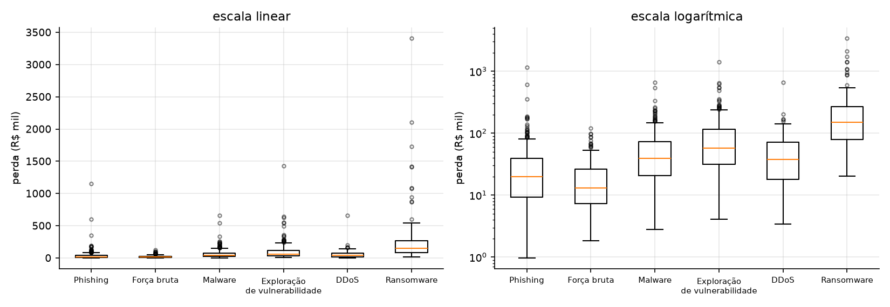
*Figura `q04b_boxplot`* Box-plots da perda por tipo de ataque.


### 4-c) Assimetria e curtose


**Tabela `q04c_formato`** Medidas de formato (Normal: assimetria 0, curtose 3).

|                   |   perda_rs |   ln(perda_rs) |
|:------------------|-----------:|---------------:|
| assimetria        |     10.021 |          0.237 |
| curtose (excesso) |    145.892 |          0.210 |
| curtose           |    148.892 |          3.210 |
| média             | 72,708.747 |         10.396 |
| mediana           | 31,710.730 |         10.364 |


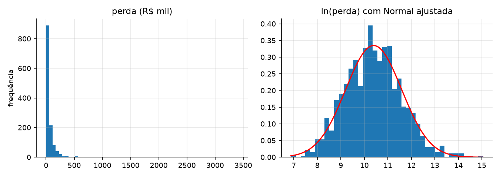
*Figura `q04c_histogramas`* A transformação logarítmica torna a perda quase simétrica.


### 4-d) Covariâncias e correlações (painel trimestral)


**Tabela `q04d_covariancias`** Matriz de covariâncias.

|             |   n_ataques |        perda_total |   servicos |     patch |      treino |        soc |
|:------------|------------:|-------------------:|-----------:|----------:|------------:|-----------:|
| n_ataques   |       22.30 |         936,080.89 |      17.77 |     -1.21 |       -3.04 |      -0.60 |
| perda_total |  936,080.89 | 245,602,729,396.11 | 616,312.29 | 25,907.97 | -186,510.11 | -81,810.88 |
| servicos    |       17.77 |         616,312.29 |      37.03 |     -2.34 |        0.05 |      -0.50 |
| patch       |       -1.21 |          25,907.97 |      -2.34 |     41.28 |        1.54 |      -1.02 |
| treino      |       -3.04 |        -186,510.11 |       0.05 |      1.54 |       10.85 |      -0.13 |
| soc         |       -0.60 |         -81,810.88 |      -0.50 |     -1.02 |       -0.13 |       0.25 |


**Tabela `q04d_correlacoes`** Matriz de correlações de Pearson.

|             |   n_ataques |   perda_total |   servicos |   patch |   treino |    soc |
|:------------|------------:|--------------:|-----------:|--------:|---------:|-------:|
| n_ataques   |       1.000 |         0.400 |      0.619 |  -0.040 |   -0.195 | -0.253 |
| perda_total |       0.400 |         1.000 |      0.204 |   0.008 |   -0.114 | -0.331 |
| servicos    |       0.619 |         0.204 |      1.000 |  -0.060 |    0.002 | -0.163 |
| patch       |      -0.040 |         0.008 |     -0.060 |   1.000 |    0.073 | -0.319 |
| treino      |      -0.195 |        -0.114 |      0.002 |   0.073 |    1.000 | -0.080 |
| soc         |      -0.253 |        -0.331 |     -0.163 |  -0.319 |   -0.080 |  1.000 |


### 4-e) VaR histórico de 95% da perda mensal

- `q4e.var95_mensal` = 4,914,169.41
- `q4e.media_mensal` = 2,601,357.38
- `q4e.mediana_mensal` = 2,357,993.71
- `q4e.ic95_bootstrap_inf` = 3,560,823.59
- `q4e.ic95_bootstrap_sup` = 6,302,990.41

**Tabela `q04e_maiores_meses`** Os quatro meses de maior perda: o P95 é interpolado entre os dois primeiros.

| mes_ref   |   perda_total |
|:----------|--------------:|
| 2025-04   |  6,302,990.41 |
| 2023-08   |  5,543,351.31 |
| 2024-05   |  4,704,442.11 |
| 2024-02   |  4,253,043.70 |


## Questão 5 - Probabilidade e Bayes (cap. 3)


### 5-a) Tabela de contingência tipo × materializou


**Tabela `q05a_contingencia`** Frequências absolutas.

| tipo                          |   não materializou |   materializou |   total |
|:------------------------------|-------------------:|---------------:|--------:|
| Phishing                      |                645 |            386 |    1031 |
| Força bruta                   |                432 |            193 |     625 |
| Malware                       |                273 |            220 |     493 |
| Exploração de vulnerabilidade |                193 |            245 |     438 |
| DDoS                          |                194 |            138 |     332 |
| Ransomware                    |                 38 |            106 |     144 |
| Total                         |               1775 |           1288 |    3063 |


**Tabela `q05a_conjuntas`** Probabilidades conjuntas e marginais.

| tipo                          |   não materializou |   materializou |   total |
|:------------------------------|-------------------:|---------------:|--------:|
| Phishing                      |             0.2106 |         0.1260 |  0.3366 |
| Força bruta                   |             0.1410 |         0.0630 |  0.2040 |
| Malware                       |             0.0891 |         0.0718 |  0.1610 |
| Exploração de vulnerabilidade |             0.0630 |         0.0800 |  0.1430 |
| DDoS                          |             0.0633 |         0.0451 |  0.1084 |
| Ransomware                    |             0.0124 |         0.0346 |  0.0470 |
| Total                         |             0.5795 |         0.4205 |  1.0000 |


**Tabela `q05a_condicionais`** Condicionais nas duas direções.

| tipo                          |   P(tipo) |   P(materializou | tipo) |   P(tipo | materializou) |
|:------------------------------|----------:|-------------------------:|-------------------------:|
| Phishing                      |    0.3366 |                   0.3744 |                   0.2997 |
| Força bruta                   |    0.2040 |                   0.3088 |                   0.1498 |
| Malware                       |    0.1610 |                   0.4462 |                   0.1708 |
| Exploração de vulnerabilidade |    0.1430 |                   0.5594 |                   0.1902 |
| DDoS                          |    0.1084 |                   0.4157 |                   0.1071 |
| Ransomware                    |    0.0470 |                   0.7361 |                   0.0823 |
| Total                         |    1.0000 |                   0.4205 |                   1.0000 |

- `q5a.P_mat_dado_ransomware` = 0.7361
- `q5a.P_ransomware_dado_mat` = 0.0823

### 5-b) Independência entre SOC e materialização

- `q5b.P_soc` = 0.4858
- `q5b.P_mat` = 0.4205
- `q5b.P_soc_e_mat` = 0.1401
- `q5b.P_soc_x_P_mat` = 0.2043
- `q5b.P_mat_dado_soc` = 0.2883
- `q5b.P_mat_dado_sem_soc` = 0.5454
- `q5b.qui2` = 207.5334
- `q5b.qui2_pvalor` = 4.743e-47

### 5-c) Triagem 'alarme se cvss ≥ 7' e Teorema de Bayes


**Tabela `q05c_triagem`** Contagens.

|            |   materializou |   não materializou |
|:-----------|---------------:|-------------------:|
| alarme     |            401 |                250 |
| sem alarme |            887 |               1525 |

- `q5c.sensibilidade` = 0.3113
- `q5c.especificidade` = 0.8592
- `q5c.prevalencia` = 0.4205
- `q5c.P_alarme` = 0.2125
- `q5c.VPP_bayes` = 0.6160
- `q5c.VPP_contagem_direta` = 0.6160
- `q5c.VPN` = 0.6323

### 5-d) Árvore de triagem e prevalência pela metade


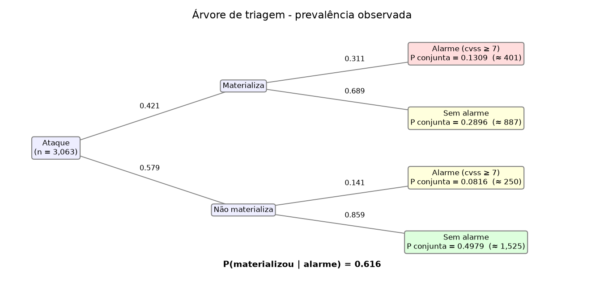
*Figura `q05d_arvore`* Árvore de triagem com os números da base.

- `q5d.prevalencia_metade` = 0.2103
- `q5d.VPP_prevalencia_metade` = 0.3705

**Tabela `q05d_vpp_prevalencia`** Valor preditivo positivo em função da prevalência (sens. e espec. fixas).

|   prevalência |    VPP |
|--------------:|-------:|
|        0.0500 | 0.1042 |
|        0.1000 | 0.1972 |
|        0.2103 | 0.3705 |
|        0.3000 | 0.4865 |
|        0.4205 | 0.6160 |
|        0.6000 | 0.7683 |


## Questão 6 - Distribuições (cap. 4 e 5)


### 6-a) Poisson: P(N ≥ 6) em um mês, unidade sem SOC


**Tabela `q06a_poisson`** Unidades sem SOC (36 meses cada).

| unidade   |   média mensal |   variância |   P(N≥6) Poisson |   freq. empírica N≥6 |   meses com N≥6 |
|:----------|---------------:|------------:|-----------------:|---------------------:|----------------:|
| U05       |         4.0833 |      4.4786 |           0.2280 |               0.2500 |          9.0000 |
| U06       |         5.9444 |      6.4540 |           0.5454 |               0.5833 |         21.0000 |
| U08       |         2.9167 |      3.2214 |           0.0758 |               0.1111 |          4.0000 |
| U12       |         4.7500 |      6.4786 |           0.3403 |               0.3611 |         13.0000 |
| U13       |         3.6389 |      3.0373 |           0.1613 |               0.1111 |          4.0000 |
| U15       |         4.8056 |      4.2754 |           0.3500 |               0.3611 |         13.0000 |
| U16       |         4.0278 |      3.5706 |           0.2192 |               0.2500 |          9.0000 |
| U17       |         2.9444 |      2.3968 |           0.0784 |               0.0556 |          2.0000 |
| U20       |         3.8611 |      3.6087 |           0.1936 |               0.1944 |          7.0000 |
| U21       |         3.9444 |      3.5968 |           0.2062 |               0.2222 |          8.0000 |
| U23       |         2.8333 |      3.7429 |           0.0681 |               0.0833 |          3.0000 |

- `q6a.unidade_escolhida` = U06
- `q6a.media_mensal` = 5.9444
- `q6a.P_teorica` = 0.5454
- `q6a.freq_empirica` = 0.5833
- `q6a.meses_com_6_ou_mais` = 21
- `q6a.erro_padrao_freq` = 0.0830

### 6-b) Exponencial: P(tempo > 8 h), com SOC e em expediente

- `q6b.n` = 976
- `q6b.media_observada` = 3.8793
- `q6b.desvio_observado` = 3.6584
- `q6b.P_teorica_theta_estimado` = 0.1272
- `q6b.P_teorica_theta_4` = 0.1353
- `q6b.P_observada` = 0.1270
- `q6b.erro_padrao` = 0.0109

### 6-c) Q-Q de ln(perda) e escore Z da maior perda


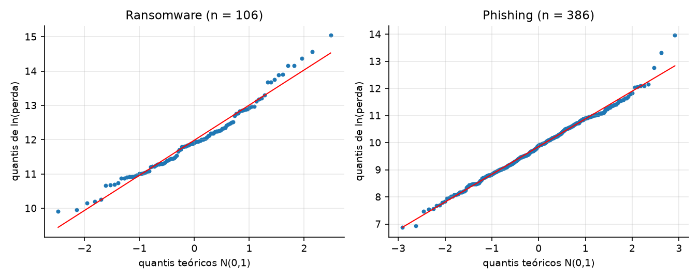
*Figura `q06c_qq`* Gráficos Q-Q de ln(perda) contra a Normal.


**Tabela `q06c_lognormal`** Aderência Lognormal e maior perda.

|                         |     Ransomware |       Phishing |
|:------------------------|---------------:|---------------:|
| n                       |       106.0000 |       386.0000 |
| média ln                |        11.9852 |         9.8547 |
| dp ln                   |         1.0221 |         1.0211 |
| mediana (R$)            |   149,280.9000 |    19,880.6550 |
| exp(média ln) (R$)      |   160,369.7930 |    19,046.8053 |
| r do Q-Q                |         0.9870 |         0.9963 |
| Shapiro-Wilk W          |         0.9735 |         0.9940 |
| Shapiro-Wilk p          |         0.0322 |         0.1320 |
| assimetria ln           |         0.5721 |         0.1410 |
| maior perda (R$)        | 3,407,216.1500 | 1,151,367.2500 |
| Z da maior (em ln)      |         2.9900 |         4.0169 |
| Z da maior (em R$)      |         6.6505 |        15.3990 |
| P(Z > z) em ln          |         0.0014 |         0.0000 |
| nº esperado acima (n·P) |         0.1479 |         0.0114 |


## Questão 7 - Amostragem e estimação (cap. 6)


### 7-a) IC de 95% para o tempo médio de detecção


**Tabela `q07a_ic_tempo`** IC t de Student, 95%.

|                            |    n |   média |   desvio-padrão |   IC inf |   IC sup |   θ programado | IC contém θ   |   média implícita no gerador | IC contém a média implícita   |
|:---------------------------|-----:|--------:|----------------:|---------:|---------:|---------------:|:--------------|-----------------------------:|:------------------------------|
| com SOC - todos os ataques | 1488 |   4.514 |           4.684 |    4.276 |    4.752 |          4.000 | False         |                        4.700 | True                          |
| com SOC - só em expediente |  976 |   3.879 |           3.658 |    3.649 |    4.109 |          4.000 | True          |                        4.000 | True                          |
| sem SOC - todos os ataques | 1575 |  14.391 |          15.228 |   13.639 |   15.144 |         12.000 | False         |                       14.100 | True                          |
| sem SOC - só em expediente |  996 |  11.939 |          11.864 |   11.201 |   12.677 |         12.000 | True          |                       12.000 | True                          |

- `q7a.prop_fora_expediente` = 0.3562

### 7-b) IC de 95% para a proporção de materializados e tamanho de amostra

- `q7b.n` = 3063
- `q7b.p_chapeu` = 0.4205
- `q7b.margem` = 0.0175
- `q7b.ic_inf` = 0.4030
- `q7b.ic_sup` = 0.4380
- `q7b.n_para_2pp_com_p_chapeu` = 2341
- `q7b.n_para_2pp_conservador` = 2401

### 7-c) Teorema Central do Limite com perda_rs


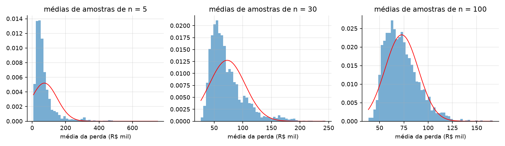
*Figura `q07c_tcl`* 2.000 médias amostrais por tamanho; em vermelho, N(μ, σ²/n).

- `q7c.mu_base` = 72,708.75
- `q7c.sigma_base` = 171,282.87
- `q7c.assimetria_base` = 10.0211

**Tabela `q07c_tcl`** Distribuição amostral da média.

|                        |      n = 5 |     n = 30 |    n = 100 |
|:-----------------------|-----------:|-----------:|-----------:|
| média das médias       | 72,521.238 | 72,095.907 | 72,615.728 |
| desvio das médias      | 68,479.691 | 30,268.717 | 17,052.366 |
| σ/√n                   | 76,600.026 | 31,271.830 | 17,128.287 |
| razão                  |      0.894 |      0.968 |      0.996 |
| assimetria das médias  |      3.314 |      1.598 |      0.942 |
| curtose (excesso)      |     15.262 |      3.145 |      1.275 |
| Shapiro-Wilk p         |      0.000 |      0.000 |      0.000 |
| % fora de μ ± 1,96σ/√n |      4.300 |      4.700 |      4.450 |


## Questão 8 - Testes de hipóteses e backtesting (cap. 7)


### 8-a) Teste t unilateral: H0 μ ≤ 4 h x Ha μ > 4 h (unidades com SOC)

- `q8a.todos.n` = 1488
- `q8a.todos.media` = 4.5142
- `q8a.todos.desvio` = 4.6844
- `q8a.todos.t` = 4.2342
- `q8a.todos.t_critico` = 1.6459
- `q8a.todos.p_valor` = 1.217e-05
- `q8a.so_expediente.n` = 976
- `q8a.so_expediente.media` = 3.8793
- `q8a.so_expediente.desvio` = 3.6584
- `q8a.so_expediente.t` = -1.0309
- `q8a.so_expediente.t_critico` = 1.6464
- `q8a.so_expediente.p_valor` = 8.486e-01

### 8-b) Teste para proporção: H0 p ≤ 0,40 x Ha p > 0,40

- `q8b.n` = 3063
- `q8b.p_chapeu` = 0.4205
- `q8b.z` = 2.3162
- `q8b.z_critico` = 1.6449
- `q8b.p_valor` = 0.0103

### 8-d) Backtesting do VaR de 95% da perda mensal por unidade (Kupiec)

- `q8d.n_treino` = 576
- `q8d.var95_unidade_mes` = 365,991.64
- `q8d.media_treino` = 107,862.39
- `q8d.media_teste` = 109,444.89
- `q8d.T` = 288
- `q8d.excecoes_esperadas` = 14.4
- `q8d.excecoes_observadas` = 17
- `q8d.taxa_excecoes` = 0.0590
- `q8d.LR` = 0.4683
- `q8d.qui2_critico` = 3.8415
- `q8d.p_valor` = 0.4938

**Tabela `q08d_excecoes_mes`** Exceções por mês de 2025 (24 unidades por mês).

|         |   exceções |   perda total (R$) |
|:--------|-----------:|-------------------:|
| 2025-01 |          2 |          2,342,071 |
| 2025-02 |          1 |          2,391,222 |
| 2025-03 |          0 |          1,897,443 |
| 2025-04 |          6 |          6,302,990 |
| 2025-05 |          1 |          2,373,916 |
| 2025-06 |          2 |          3,137,226 |
| 2025-07 |          0 |          1,588,172 |
| 2025-08 |          2 |          2,834,733 |
| 2025-09 |          1 |          2,233,815 |
| 2025-10 |          0 |          2,064,741 |
| 2025-11 |          2 |          2,622,549 |
| 2025-12 |          0 |          1,731,251 |

- `q8d.sem_abril.excecoes` = 11
- `q8d.sem_abril.T` = 264
- `q8d.sem_abril.LR` = 0.4082
- `q8d.sem_abril.p_valor` = 0.5229

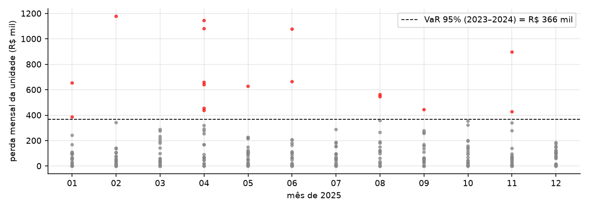
*Figura `q08d_backtesting`* Backtesting: perdas por unidade-mês em 2025 e exceções (vermelho).


## Questão 9 - Correlação e regressão simples (cap. 8)


### 9-a) Dispersão e correlação


**Tabela `q09a_correlacao`** Teste de H0: ρ = 0.

|                     |     perda_rs |   ln(perda_rs) |
|:--------------------|-------------:|---------------:|
| r                   |     0.246806 |       0.244848 |
| r²                  |     0.060913 |       0.059951 |
| t                   |     9.133224 |       9.056129 |
| g.l.                | 1,286.000000 |   1,286.000000 |
| p-valor (bilateral) |     0.000000 |       0.000000 |


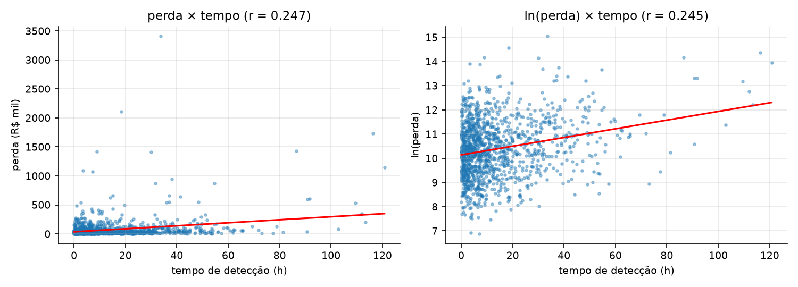
*Figura `q09a_dispersao`* Diagramas de dispersão com a reta de mínimos quadrados.


### 9-b/c) Mínimos quadrados: ln(perda) = β0 + β1·tempo + erro


**Tabela `q09b_coeficientes`** Regressão simples.

|                  |   coeficiente |   erro padrão |         t |   p-valor |   IC 95% inf |   IC 95% sup |
|:-----------------|--------------:|--------------:|----------:|----------:|-------------:|-------------:|
| Intercept        |      10.14112 |       0.04272 | 237.36125 |   0.00000 |     10.05730 |     10.22494 |
| tempo_deteccao_h |       0.01796 |       0.00198 |   9.05613 |   0.00000 |      0.01407 |      0.02185 |

- `q9b.beta0` = 10.14112
- `q9b.beta1` = 0.01796
- `q9b.variacao_pct_por_hora` = 1.8125
- `q9b.variacao_pct_por_10h` = 19.6775
- `q9b.exp_beta0` = 25,364.84
- `q9c.R2` = 0.0600
- `q9c.erro_padrao_regressao` = 1.1551
- `q9c.n` = 1288
- `q9c.variancia_ln_perda` = 1.4183
- `q9c.variancia_entre_tipos` = 0.4837
- `q9d.corr_tempo_soc` = -0.3677

## Questão 10 - Inferência na regressão (cap. 9)


### 10-a) Tabela ANOVA e F = t²


**Tabela `q10a_anova`** ANOVA da regressão simples.

|           |         SQ |       g.l. |       QM |        F |   p-valor |
|:----------|-----------:|-----------:|---------:|---------:|----------:|
| Regressão |   109.4337 |     1.0000 | 109.4337 |  82.0135 |    0.0000 |
| Resíduo   | 1,715.9579 | 1,286.0000 |   1.3343 | nan      |  nan      |
| Total     | 1,825.3915 | 1,287.0000 | nan      | nan      |  nan      |

- `q10a.F` = 82.0135
- `q10a.t_beta1` = 9.0561
- `q10a.t_ao_quadrado` = 82.0135
- `q10a.F_critico` = 3.8487

### 10-b) IC de 95% para β1

- `q10b.beta1` = 0.01796
- `q10b.ic_inf` = 0.01407
- `q10b.ic_sup` = 0.02185
- `q10b.contem_0_02` = True

### 10-c) Intervalos para um ataque detectado em 24 h


**Tabela `q10c_intervalos_24h`** IC para a média e intervalo de previsão (95%).

|                     |   ln(perda) |          R$ |
|:--------------------|------------:|------------:|
| estimativa pontual  |      10.572 |  39,035.745 |
| IC da média - inf   |      10.498 |  36,257.305 |
| IC da média - sup   |      10.646 |  42,027.101 |
| IP individual - inf |       8.305 |   4,043.533 |
| IP individual - sup |      12.840 | 376,846.007 |

- `q10c.razao_ic_media` = 1.1591
- `q10c.razao_ip_individual` = 93.1972
- `q10c.tempo_medio_amostra` = 14.1648

### 10-d) Regressão com dummies de tipo de ataque


**Tabela `q10d_coeficientes`** ln(perda) ~ tempo + tipo (base: Phishing).

|                                     |   coeficiente |   erro padrão |         t |   p-valor |   IC 95% inf |   IC 95% sup |
|:------------------------------------|--------------:|--------------:|----------:|----------:|-------------:|-------------:|
| Intercept                           |       9.50864 |       0.05256 | 180.89959 |   0.00000 |      9.40552 |      9.61176 |
| tipo: DDoS                          |       0.69000 |       0.08981 |   7.68285 |   0.00000 |      0.51381 |      0.86619 |
| tipo: Exploração de vulnerabilidade |       1.21482 |       0.07413 |  16.38862 |   0.00000 |      1.06940 |      1.36024 |
| tipo: Força bruta                   |      -0.30868 |       0.07981 |  -3.86783 |   0.00012 |     -0.46524 |     -0.15211 |
| tipo: Malware                       |       0.85051 |       0.07695 |  11.05338 |   0.00000 |      0.69956 |      1.00147 |
| tipo: Ransomware                    |       2.18069 |       0.09933 |  21.95392 |   0.00000 |      1.98582 |      2.37556 |
| tempo_deteccao_h                    |       0.02142 |       0.00157 |  13.67665 |   0.00000 |      0.01835 |      0.02449 |


**Tabela `q10d_medianas`** exp(β0 + dummy) x mediana do gerador.

|                               |   mediana estimada (tempo = 0) |   mediana programada |   razão |
|:------------------------------|-------------------------------:|---------------------:|--------:|
| Phishing                      |                     13,475.699 |           15,000.000 |   0.898 |
| Força bruta                   |                      9,896.801 |           10,000.000 |   0.990 |
| Malware                       |                     31,544.551 |           30,000.000 |   1.051 |
| Exploração de vulnerabilidade |                     45,408.794 |           45,000.000 |   1.009 |
| DDoS                          |                     26,866.607 |           25,000.000 |   1.075 |
| Ransomware                    |                    119,292.323 |          150,000.000 |   0.795 |


**Tabela `q10d_comparacao`** Efeito de controlar o tipo (σ programado = 0,9).

|                          |   só tempo |   tempo + tipo |
|:-------------------------|-----------:|---------------:|
| R²                       |    0.05995 |        0.42497 |
| R² ajustado              |    0.05922 |        0.42227 |
| erro padrão da regressão |    1.15514 |        0.90521 |
| β1                       |    0.01796 |        0.02142 |
| EP(β1)                   |    0.00198 |        0.00157 |
| IC inf                   |    0.01407 |        0.01835 |
| IC sup                   |    0.02185 |        0.02449 |
| amplitude do IC          |    0.00778 |        0.00615 |

- `q10d.contem_0_02` = True

## Questão 11 - Regressão múltipla (cap. 10)


### 11-a/b/c) Modelo base, testes e comparação com o gerador


**Tabela `q11a_coeficientes`** n_ataques por unidade-trimestre (n = 288).

|           |   coeficiente |   erro padrão |       t |   p-valor |   IC 95% inf |   IC 95% sup |   verdadeiro | IC contém o verdadeiro   |
|:----------|--------------:|--------------:|--------:|----------:|-------------:|-------------:|-------------:|:-------------------------|
| Intercept |        5.5328 |        2.8708 |  1.9273 |    0.0550 |      -0.1182 |      11.1839 |       8.0000 | sim                      |
| servicos  |        0.4540 |        0.0337 | 13.4615 |    0.0000 |       0.3876 |       0.5203 |       0.5000 | sim                      |
| patch     |       -0.0371 |        0.0333 | -1.1159 |    0.2654 |      -0.1027 |       0.0284 |      -0.0800 | sim                      |
| treino    |       -0.2983 |        0.0613 | -4.8673 |    0.0000 |      -0.4189 |      -0.1776 |      -0.2000 | sim                      |
| soc       |       -1.7977 |        0.4338 | -4.1443 |    0.0000 |      -2.6516 |      -0.9438 |      -1.4000 | sim                      |
| trimestre |        0.2615 |        0.0581 |  4.4992 |    0.0000 |       0.1471 |       0.3759 |       0.1500 | sim                      |

- `q11b.F` = 54.0099
- `q11b.F_pvalor` = 3.245e-39
- `q11b.R2` = 0.4892
- `q11b.R2_ajustado` = 0.4801
- `q11b.erro_padrao_regressao` = 3.4051
- `q11b.media_n_ataques` = 10.6354
- `q11c.ics_que_contem_inclinacoes` = 5
- `q11c.ics_que_contem_total` = 6

### 11-d) Dummies de trimestre do ano e indicador da campanha


**Tabela `q11d_coeficientes`** Campanha = trimestre 10.

|           |   coeficiente |   erro padrão |       t |   p-valor |   IC 95% inf |   IC 95% sup |   verdadeiro | IC contém o verdadeiro   |
|:----------|--------------:|--------------:|--------:|----------:|-------------:|-------------:|-------------:|:-------------------------|
| Intercept |        5.9242 |        2.8197 |  2.1010 |    0.0365 |       0.3735 |      11.4749 |       8.0000 | sim                      |
| Q2        |       -0.6154 |        0.6232 | -0.9874 |    0.3243 |      -1.8422 |       0.6115 |     nan      | -                        |
| Q3        |        0.2447 |        0.5700 |  0.4292 |    0.6681 |      -0.8774 |       1.3667 |     nan      | -                        |
| Q4        |        0.8739 |        0.5891 |  1.4835 |    0.1391 |      -0.2858 |       2.0336 |     nan      | -                        |
| servicos  |        0.4540 |        0.0329 | 13.7837 |    0.0000 |       0.3891 |       0.5188 |       0.5000 | sim                      |
| patch     |       -0.0371 |        0.0325 | -1.1426 |    0.2542 |      -0.1011 |       0.0269 |      -0.0800 | sim                      |
| treino    |       -0.2983 |        0.0598 | -4.9838 |    0.0000 |      -0.4161 |      -0.1804 |      -0.2000 | sim                      |
| soc       |       -1.7977 |        0.4236 | -4.2435 |    0.0000 |      -2.6317 |      -0.9638 |      -1.4000 | sim                      |
| trimestre |        0.1346 |        0.0666 |  2.0224 |    0.0441 |       0.0036 |       0.2656 |       0.1500 | sim                      |
| campanha  |        3.6923 |        0.9223 |  4.0033 |    0.0001 |       1.8767 |       5.5079 |     nan      | -                        |


**Tabela `q11d_comparacao`** Ajuste com e sem as dummies.

|             |       base |   com dummies |
|:------------|-----------:|--------------:|
| R²          |     0.4892 |        0.5197 |
| R² ajustado |     0.4801 |        0.5041 |
| AIC         | 1,528.9973 |    1,519.2581 |
| BIC         | 1,550.9750 |    1,555.8877 |
| erro padrão |     3.4051 |        3.3255 |

- `q11d.F_parcial` = 4.4154
- `q11d.F_parcial_pvalor` = 1.780e-03
- `q11d.gl_F_parcial` = 4
- `q11d.nivel_medio_lambda_trim` = 10.6623
- `q11d.esperado_Q2_menos_Q1` = 0.7108
- `q11d.esperado_Q3_menos_Q1` = 0.0000
- `q11d.esperado_Q4_menos_Q1` = 1.4216
- `q11d.esperado_campanha` = 3.2816

### 11-e) VIFs e diagnóstico de resíduos


**Tabela `q11e_vif`** Fatores de inflação da variância (modelo base).

|           |   VIF |
|:----------|------:|
| servicos  | 1.042 |
| patch     | 1.132 |
| treino    | 1.009 |
| soc       | 1.160 |
| trimestre | 1.000 |

- `q11e.breusch_pagan_LM` = 8.9884
- `q11e.breusch_pagan_pvalor` = 1.095e-01
- `q11e.shapiro_residuos_p` = 5.158e-01
- `q11e.breusch_pagan_ajustados_LM` = 5.8001
- `q11e.breusch_pagan_ajustados_pvalor` = 0.0160
- `q11e.spearman_absres_ajustado` = 0.1521
- `q11e.spearman_pvalor` = 0.0098
- `q11e.variancia_residuos` = 11.5945

**Tabela `q11e_funil`** Poisson: variância do erro ≈ média ajustada.

|                  |   média dos ajustados |   variância dos resíduos |   variância/média |
|:-----------------|----------------------:|-------------------------:|------------------:|
| ajustados baixos |                 6.896 |                    9.819 |             1.424 |
| médios           |                10.729 |                    9.018 |             0.841 |
| altos            |                14.281 |                   15.569 |             1.090 |


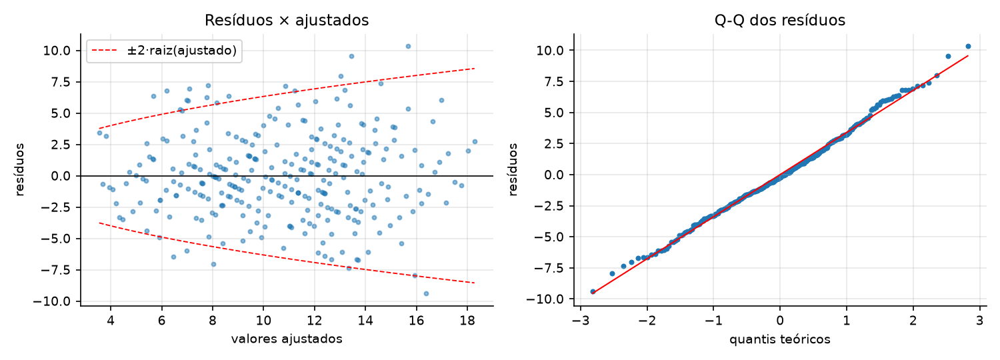
*Figura `q11e_residuos`* Diagnóstico de resíduos do modelo base.


### 11-f) Sobreajuste: cinco variáveis de ruído puro


**Tabela `q11f_sobreajuste`** Treino: trimestres 1–8 (2023–2024); teste: 9–12 (2025).

|                         |   sem ruído |   com 5 ruídos |
|:------------------------|------------:|---------------:|
| parâmetros              |      6.0000 |        11.0000 |
| R² treino               |      0.4635 |         0.4670 |
| R² ajustado treino      |      0.4490 |         0.4375 |
| REQM treino             |      3.3369 |         3.3259 |
| REQM teste              |      3.4985 |         3.5466 |
| EAM teste               |      2.7716 |         2.7811 |
| viés teste (obs − prev) |      0.6317 |         0.5876 |
| R² teste                |      0.4699 |         0.4553 |


## Questão 12 - Séries temporais (cap. 11, Parte A)


### 12-a) Médias móveis e suavização exponencial

- `q12a.alfa_otimo_previsao_1_passo` = 0.20
- `q12a.media_2023` = 78.50
- `q12a.media_2024` = 82.25
- `q12a.media_2025` = 94.50
- `q12a.media_2025_sem_abril` = 88.91
- `q12a.tendencia_linear_por_mes` = 0.6786
- `q12a.tendencia_pvalor` = 0.0121
- `q12a.tendencia_programada_por_mes` = 0.4000

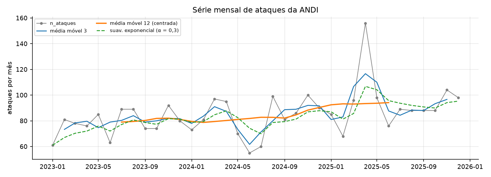
*Figura `q12a_serie`* Série, médias móveis e suavização exponencial.


### 12-b) Decomposição multiplicativa


**Tabela `q12b_indices_sazonais`** Índices sazonais (decomposição clássica, período 12).

|     |   índice estimado |   S_m programado |   diferença |
|:----|------------------:|-----------------:|------------:|
| Jan |             0.906 |            0.900 |       0.006 |
| Fev |             0.867 |            0.850 |       0.017 |
| Mar |             1.111 |            1.100 |       0.011 |
| Abr |             1.408 |            1.100 |       0.308 |
| Mai |             0.942 |            1.000 |      -0.058 |
| Jun |             0.730 |            0.950 |      -0.220 |
| Jul |             0.914 |            0.900 |       0.014 |
| Ago |             1.143 |            0.950 |       0.193 |
| Set |             0.941 |            1.000 |      -0.059 |
| Out |             0.947 |            1.050 |      -0.103 |
| Nov |             1.112 |            1.150 |      -0.038 |
| Dez |             0.978 |            1.050 |      -0.072 |

- `q12b.correlacao_indices` = 0.6182
- `q12b.erro_abs_medio_indices` = 0.0916
- `q12b.dp_2023` = 9.76
- `q12b.dp_2024` = 15.15

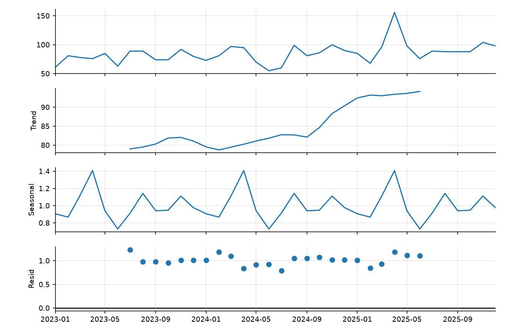
*Figura `q12b_decomposicao`* Decomposição multiplicativa: tendência, sazonalidade e resíduo.


### 12-c) Função de autocorrelação


**Tabela `q12c_acf`** Limite de significância ±0.327.

|   defasagem |    ACF | significativa (|r| > 1,96/√n)   |
|------------:|-------:|:--------------------------------|
|           1 |  0.257 | False                           |
|           2 | -0.206 | False                           |
|           3 | -0.005 | False                           |
|           4 |  0.133 | False                           |
|           5 |  0.165 | False                           |
|           6 |  0.001 | False                           |
|           7 |  0.177 | False                           |
|           8 |  0.319 | False                           |
|           9 | -0.090 | False                           |
|          10 | -0.347 | True                            |
|          11 | -0.112 | False                           |
|          12 |  0.204 | False                           |

- `q12c.limite` = 0.3267

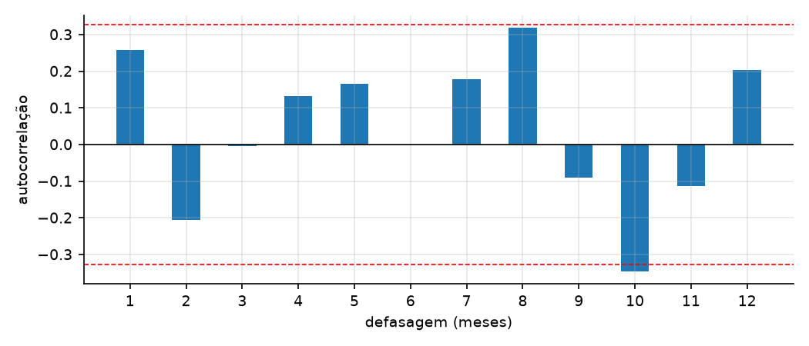
*Figura `q12c_acf`* ACF de n_ataques até a defasagem 12.


### 12-d) Previsão de 2026 e regra dos 3σ


**Tabela `q12d_maiores_residuos`** Os seis maiores |z| (tendência × sazonalidade).

| mes_ref   |   observado |   ajustado |   resíduo |      z |
|:----------|------------:|-----------:|----------:|-------:|
| 2023-04   |      76.000 |    108.054 |   -32.054 | -2.785 |
| 2025-04   |     156.000 |    128.549 |    27.451 |  2.385 |
| 2024-04   |      95.000 |    118.302 |   -23.302 | -2.025 |
| 2025-08   |      88.000 |    107.121 |   -19.121 | -1.661 |
| 2024-07   |      60.000 |     78.423 |   -18.423 | -1.601 |
| 2023-07   |      89.000 |     71.774 |    17.226 |  1.497 |

- `q12d.sigma_residuos` = 11.5083
- `q12d.z_abril_2025` = 2.3853
- `q12d.alarmes_3sigma` = nenhum
- `q12d.alarmes_2sigma` = 2023-04, 2024-04, 2025-04
- `q12d.z_abril_2025_classico_sigma_poisson` = 2.4211

**Tabela `q12d_indices_robustos`** Índices sazonais: média de 2 anos x mediana de 3 anos.

|     |   índice clássico |   índice robusto |   S_m programado |
|:----|------------------:|-----------------:|-----------------:|
| Jan |             0.906 |            0.892 |            0.900 |
| Fev |             0.867 |            0.982 |            0.850 |
| Mar |             1.111 |            1.051 |            1.100 |
| Abr |             1.408 |            1.133 |            1.100 |
| Mai |             0.942 |            1.057 |            1.000 |
| Jun |             0.730 |            0.814 |            0.950 |
| Jul |             0.914 |            0.946 |            0.900 |
| Ago |             1.143 |            1.135 |            0.950 |
| Set |             0.941 |            0.928 |            1.000 |
| Out |             0.947 |            0.928 |            1.050 |
| Nov |             1.112 |            1.128 |            1.150 |
| Dez |             0.978 |            1.005 |            1.050 |

- `q12d.robusto.erro_abs_medio_indices` = 0.0756
- `q12d.robusto.sigma_abril_2025` = 10.1511
- `q12d.robusto.z_abril_2025` = 5.2167
- `q12d.robusto.maior_z_fora_abril_2025` = 2.2964
- `q12d.robusto.alarmes_3sigma` = 2025-04

**Tabela `q12d_maiores_residuos_robusto`** Os seis maiores |z| na versão robusta.

| mes_ref   |   observado |   ajustado |   resíduo |   z robusto |
|:----------|------------:|-----------:|----------:|------------:|
| 2025-04   |     156.000 |    103.045 |    52.955 |       5.217 |
| 2024-07   |      60.000 |     80.619 |   -20.619 |      -2.296 |
| 2025-02   |      68.000 |     88.064 |   -20.064 |      -2.138 |
| 2024-05   |      70.000 |     88.733 |   -18.733 |      -1.989 |
| 2023-07   |      89.000 |     73.398 |    15.602 |       1.821 |
| 2025-08   |      88.000 |    106.149 |   -18.149 |      -1.762 |


**Tabela `q12d_previsao_2026`** Tendência linear × índices sazonais.

|            |   previsão |   limite inf (95%) |   limite sup (95%) |   previsão (índices robustos) |   esperado pelo gerador (Σλ) |
|:-----------|-----------:|-------------------:|-------------------:|------------------------------:|-----------------------------:|
| 2026-01    |       87.7 |               67.3 |              108.1 |                          86.3 |                         83.8 |
| 2026-02    |       84.5 |               64.9 |              104.0 |                          95.6 |                         79.1 |
| 2026-03    |      108.9 |               83.7 |              134.1 |                         102.9 |                        102.4 |
| 2026-04    |      138.8 |              106.7 |              170.9 |                         111.7 |                        103.7 |
| 2026-05    |       93.4 |               71.9 |              115.0 |                         104.9 |                         94.3 |
| 2026-06    |       72.8 |               56.0 |               89.6 |                          81.3 |                         89.6 |
| 2026-07    |       91.7 |               70.6 |              112.9 |                          95.1 |                         85.9 |
| 2026-08    |      115.4 |               88.8 |              142.0 |                         114.8 |                         90.7 |
| 2026-09    |       95.7 |               73.6 |              117.7 |                          94.5 |                         95.5 |
| 2026-10    |       96.8 |               74.5 |              119.1 |                          95.0 |                        101.5 |
| 2026-11    |      114.3 |               88.0 |              140.6 |                         116.3 |                        111.2 |
| 2026-12    |      101.2 |               77.9 |              124.5 |                         104.2 |                        101.5 |
| Total 2026 |    1,201.2 |              nan   |              nan   |                       1,202.4 |                      1,139.4 |

- `q12d.total_previsto_2026` = 1201.2
- `q12d.total_previsto_2026_robusto` = 1202.4
- `q12d.total_verdadeiro_2026` = 1139.4
- `q12d.eam_previsao_classica_vs_gerador` = 8.9342
- `q12d.eam_previsao_robusta_vs_gerador` = 7.8989
- `q12d.total_observado_2025` = 1134

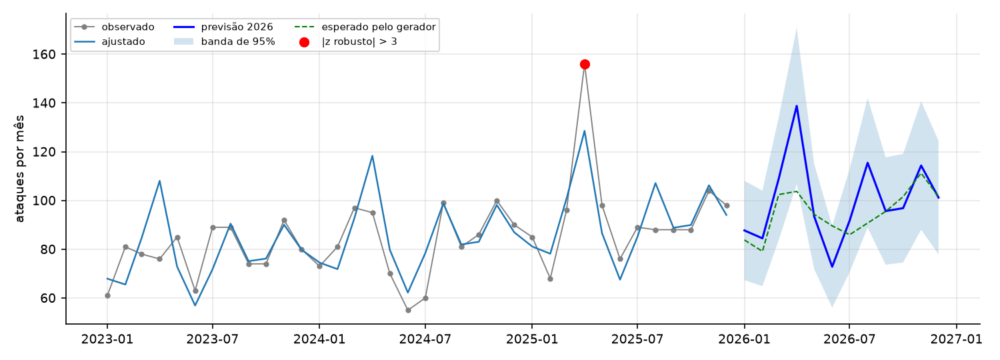
*Figura `q12d_previsao`* Previsão de 2026 com banda de incerteza e anomalias (3σ).


## Questão 13 - Classificação (cap. 11, Parte B)

- `q13.n_treino` = 1929
- `q13.n_teste` = 1134
- `q13.prevalencia_treino` = 0.4230
- `q13.prevalencia_teste` = 0.4162

### 13-a) Regressão logística


**Tabela `q13a_logistica`** Treino 2023–2024.

|                  |   coeficiente |   razão de chances e^β |   erro padrão |        z |   p-valor |   IC 95% inf |   IC 95% sup |   verdadeiro | IC contém o verdadeiro   |   e^β verdadeiro |
|:-----------------|--------------:|-----------------------:|--------------:|---------:|----------:|-------------:|-------------:|-------------:|:-------------------------|-----------------:|
| Intercept        |       -2.7531 |                 0.0637 |        0.2417 | -11.3926 |    0.0000 |      -3.2267 |      -2.2795 |      -2.8000 | sim                      |           0.0608 |
| cvss             |        0.4309 |                 1.5386 |        0.0354 |  12.1740 |    0.0000 |       0.3615 |       0.5002 |       0.4500 | sim                      |           1.5683 |
| tempo_deteccao_h |        0.0574 |                 1.0591 |        0.0062 |   9.2810 |    0.0000 |       0.0453 |       0.0695 |       0.0600 | sim                      |           1.0618 |
| soc              |       -0.7666 |                 0.4646 |        0.1149 |  -6.6739 |    0.0000 |      -0.9917 |      -0.5414 |      -0.8000 | sim                      |           0.4493 |
| treino           |       -0.0816 |                 0.9216 |        0.0162 |  -5.0333 |    0.0000 |      -0.1134 |      -0.0498 |      -0.0800 | sim                      |           0.9231 |
| fora_expediente  |        0.6365 |                 1.8898 |        0.1103 |   5.7701 |    0.0000 |       0.4203 |       0.8527 |       0.5000 | sim                      |           1.6487 |

- `q13a.pseudo_R2` = 0.1752
- `q13a.ics_que_contem` = 6

### 13-b) Dummies de tipo de ataque


**Tabela `q13b_logistica_tipo`** Com dummies de tipo (base: Phishing).

|                                     |   coeficiente |   erro padrão |       z |   p-valor |   IC 95% inf |   IC 95% sup |
|:------------------------------------|--------------:|--------------:|--------:|----------:|-------------:|-------------:|
| Intercept                           |       -2.5056 |        0.2977 | -8.4166 |    0.0000 |      -3.0891 |      -1.9221 |
| tipo: DDoS                          |        0.1148 |        0.1808 |  0.6351 |    0.5254 |      -0.2395 |       0.4692 |
| tipo: Exploração de vulnerabilidade |       -0.0021 |        0.2037 | -0.0105 |    0.9916 |      -0.4015 |       0.3972 |
| tipo: Força bruta                   |       -0.1282 |        0.1535 | -0.8350 |    0.4037 |      -0.4290 |       0.1727 |
| tipo: Malware                       |       -0.0308 |        0.1668 | -0.1844 |    0.8537 |      -0.3577 |       0.2962 |
| tipo: Ransomware                    |        0.7377 |        0.3077 |  2.3976 |    0.0165 |       0.1346 |       1.3407 |
| cvss                                |        0.3848 |        0.0500 |  7.6946 |    0.0000 |       0.2868 |       0.4828 |
| tempo_deteccao_h                    |        0.0574 |        0.0062 |  9.2601 |    0.0000 |       0.0453 |       0.0695 |
| soc                                 |       -0.7671 |        0.1154 | -6.6468 |    0.0000 |      -0.9932 |      -0.5409 |
| treino                              |       -0.0827 |        0.0163 | -5.0722 |    0.0000 |      -0.1147 |      -0.0508 |
| fora_expediente                     |        0.6474 |        0.1106 |  5.8537 |    0.0000 |       0.4307 |       0.8642 |

- `q13b.razao_verossimilhanca` = 9.0063
- `q13b.gl` = 5
- `q13b.p_valor` = 0.1088
- `q13b.AIC_sem_tipo` = 2179.90
- `q13b.AIC_com_tipo` = 2180.89
- `q13b.dummies_significativas_5pct` = 1
- `q13b.so_tipo_LR_pvalor` = 1.949e-18

### 13-c) Árvore de decisão (profundidade máxima 3)

```
|--- tempo_deteccao_h <= 12.84
|   |--- cvss <= 6.55
|   |   |--- soc <= 0.50
|   |   |   |--- weights: [269.00, 148.00] class: 0
|   |   |--- soc >  0.50
|   |   |   |--- weights: [495.00, 126.00] class: 0
|   |--- cvss >  6.55
|   |   |--- cvss <= 7.65
|   |   |   |--- weights: [145.00, 125.00] class: 0
|   |   |--- cvss >  7.65
|   |   |   |--- weights: [50.00, 110.00] class: 1
|--- tempo_deteccao_h >  12.84
|   |--- tempo_deteccao_h <= 25.66
|   |   |--- cvss <= 4.15
|   |   |   |--- weights: [46.00, 19.00] class: 0
|   |   |--- cvss >  4.15
|   |   |   |--- weights: [79.00, 137.00] class: 1
|   |--- tempo_deteccao_h >  25.66
|   |   |--- treino <= 9.83
|   |   |   |--- weights: [19.00, 136.00] class: 1
|   |   |--- treino >  9.83
|   |   |   |--- weights: [10.00, 15.00] class: 1
```


**Tabela `q13c_importancias`** Importância das variáveis na árvore.

|                  |   importância |
|:-----------------|--------------:|
| cvss             |        0.4035 |
| tempo_deteccao_h |        0.5114 |
| soc              |        0.0661 |
| treino           |        0.0190 |
| fora_expediente  |        0.0000 |


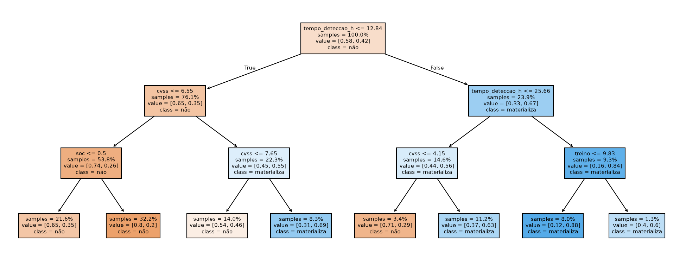
*Figura `q13c_arvore`* Árvore de decisão (treino 2023–2024).


### 13-d) Avaliação no teste (2025)


**Tabela `q13d_metricas`** Limiar 0,5. Matriz de confusão em VP/FP/FN/VN.

|          |   Logística |   Árvore |
|:---------|------------:|---------:|
| limiar   |      0.5000 |   0.5000 |
| VP       |    279.0000 | 227.0000 |
| FP       |    140.0000 | 104.0000 |
| FN       |    193.0000 | 245.0000 |
| VN       |    522.0000 | 558.0000 |
| acurácia |      0.7063 |   0.6922 |
| precisão |      0.6659 |   0.6858 |
| recall   |      0.5911 |   0.4809 |
| F1       |      0.6263 |   0.5654 |
| AUC      |      0.7726 |   0.7316 |


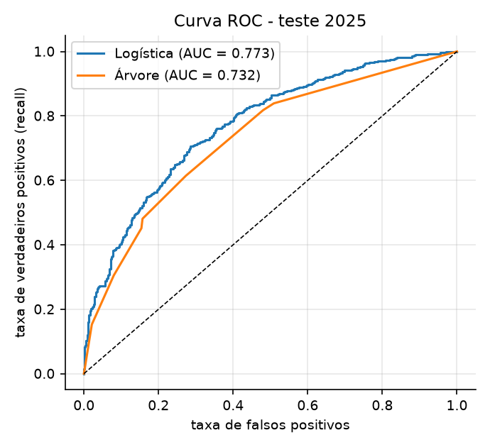
*Figura `q13d_roc`* Curvas ROC dos dois classificadores.


### 13-e) Limiar de custo mínimo

- `q13e.custo_FN_mediana_treino` = 30,598.69
- `q13e.mediana_perda_base_inteira` = 31,710.73
- `q13e.custo_FP` = 3,000.00
- `q13e.limiar_teorico` = 0.0893

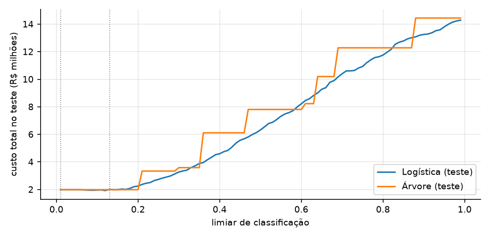
*Figura `q13e_custo`* Custo esperado por limiar (linha pontilhada: limiar escolhido no treino).


**Tabela `q13e_custo`** Limiar escolhido no treino e avaliado no teste.

|                               |   Logística - limiar 0,5 |   Logística - limiar de custo mínimo |   Árvore - limiar 0,5 |   Árvore - limiar de custo mínimo |
|:------------------------------|-------------------------:|-------------------------------------:|----------------------:|----------------------------------:|
| limiar                        |                    0.500 |                                0.130 |                 0.500 |                             0.010 |
| VP                            |                  279.000 |                              463.000 |               227.000 |                           472.000 |
| FP                            |                  140.000 |                              580.000 |               104.000 |                           662.000 |
| FN                            |                  193.000 |                                9.000 |               245.000 |                             0.000 |
| VN                            |                  522.000 |                               82.000 |               558.000 |                             0.000 |
| acurácia                      |                    0.706 |                                0.481 |                 0.692 |                             0.416 |
| precisão                      |                    0.666 |                                0.444 |                 0.686 |                             0.416 |
| recall                        |                    0.591 |                                0.981 |                 0.481 |                             1.000 |
| F1                            |                    0.626 |                                0.611 |                 0.565 |                             0.588 |
| AUC                           |                    0.773 |                                0.773 |                 0.732 |                             0.732 |
| custo no teste (R$)           |            6,325,548.135 |                        2,015,388.255 |         7,808,680.275 |                     1,986,000.000 |
| custo por ataque (R$)         |                5,578.085 |                            1,777.238 |             6,885.961 |                         1,751.323 |
| limiar ótimo no próprio teste |                    0.120 |                              nan     |                 0.010 |                           nan     |

- `q13e.custo_alarmar_tudo` = 1,986,000.00
- `q13e.custo_nunca_alarmar` = 14,442,584.04

## Questão 14 - Perda anual de 2026 e o pacote de controles (cap. 12)


### 14-a) Insumos estimados


**Tabela `q14a_severidade`** Lognormal de severidade por tipo, estimada em perdas.csv.

| tipo                          |   n perdas |   μ̂ (média de ln perda) |   σ̂ (dp de ln perda) |   mediana implícita e^μ̂ (R$) |   média implícita e^(μ̂+σ̂²/2) (R$) |   média amostral (R$) |   μ̂ sem SOC (modelo) |   μ̂ com SOC (modelo) |   σ̂ residual (modelo) |   participação do tipo π̂ |
|:------------------------------|-----------:|-------------------------:|----------------------:|------------------------------:|------------------------------------:|----------------------:|----------------------:|----------------------:|-----------------------:|--------------------------:|
| Phishing                      |   386.0000 |                   9.8547 |                1.0211 |                   19,046.8053 |                         32,080.6633 |           34,143.6363 |                9.9228 |                9.6747 |                 1.0122 |                    0.3366 |
| Força bruta                   |   193.0000 |                   9.5358 |                0.8955 |                   13,847.1140 |                         20,676.7572 |           20,529.3853 |                9.6014 |                9.3533 |                 0.8898 |                    0.2040 |
| Malware                       |   220.0000 |                  10.5881 |                0.9258 |                   39,659.8053 |                         60,877.8061 |           62,053.3765 |               10.6952 |               10.4472 |                 0.9136 |                    0.1610 |
| Exploração de vulnerabilidade |   245.0000 |                  10.9980 |                0.9687 |                   59,757.3402 |                         95,536.6424 |           97,260.0425 |               11.0952 |               10.8472 |                 0.9595 |                    0.1430 |
| DDoS                          |   138.0000 |                  10.5133 |                0.9404 |                   36,801.6296 |                         57,266.4672 |           56,123.7932 |               10.5888 |               10.3408 |                 0.9465 |                    0.1084 |
| Ransomware                    |   106.0000 |                  11.9852 |                1.0221 |                  160,369.7930 |                        270,391.6037 |          295,110.5087 |               12.0765 |               11.8285 |                 1.0190 |                    0.0470 |

- `q14a.delta_soc` = -0.2480
- `q14a.delta_soc_erro_padrao` = 0.0574
- `q14a.delta_soc_pvalor` = 1.689e-05
- `q14a.fator_severidade_com_soc` = 0.7803
- `q14a.tempo_medio_perdas_com_soc` = 5.7228
- `q14a.tempo_medio_perdas_sem_soc` = 18.3809
- `q14a.delta_via_beta1_x_dif_tempo` = -0.2711

**Tabela `q14a_unidades`** Frequência de 2026 e probabilidade de materialização.

| unidade   |   servicos |   patch |   treino |   soc |   λ anual (atual) |   p médio (atual) |   λ·p (atual) |   λ anual (controles) |   p médio (controles) |   λ·p (controles) |
|:----------|-----------:|--------:|---------:|------:|------------------:|------------------:|--------------:|----------------------:|----------------------:|------------------:|
| U01       |     16.000 |  78.170 |    5.200 | 1.000 |            36.052 |             0.283 |        10.187 |                25.439 |                 0.194 |             4.925 |
| U02       |     16.000 |  75.020 |    1.690 | 1.000 |            40.708 |             0.336 |        13.696 |                25.439 |                 0.194 |             4.925 |
| U03       |     28.000 |  64.190 |    9.390 | 1.000 |            54.921 |             0.225 |        12.366 |                47.229 |                 0.194 |             9.143 |
| U04       |     28.000 |  84.940 |    4.360 | 1.000 |            57.838 |             0.295 |        17.062 |                47.229 |                 0.194 |             9.143 |
| U05       |     21.000 |  82.530 |    3.960 | 0.000 |            53.154 |             0.569 |        30.232 |                34.518 |                 0.194 |             6.682 |
| U06       |     28.000 |  73.420 |    1.250 | 0.000 |            70.451 |             0.613 |        43.156 |                47.229 |                 0.194 |             9.143 |
| U07       |     12.000 |  81.030 |    9.680 | 1.000 |            23.019 |             0.221 |         5.099 |                18.175 |                 0.194 |             3.519 |
| U08       |     19.000 |  86.240 |   10.260 | 0.000 |            41.455 |             0.466 |        19.302 |                30.886 |                 0.194 |             5.979 |
| U09       |     24.000 |  72.420 |    3.880 | 1.000 |            53.008 |             0.302 |        16.022 |                39.966 |                 0.194 |             7.737 |
| U10       |     11.000 |  86.000 |    1.300 | 1.000 |            30.462 |             0.343 |        10.440 |                16.360 |                 0.194 |             3.167 |
| U11       |     16.000 |  68.630 |    6.510 | 1.000 |            35.907 |             0.264 |         9.470 |                25.439 |                 0.194 |             4.925 |
| U12       |     27.000 |  90.700 |    8.730 | 0.000 |            57.144 |             0.491 |        28.032 |                45.413 |                 0.194 |             8.792 |
| U13       |     14.000 |  69.600 |    0.110 | 0.000 |            46.957 |             0.631 |        29.613 |                21.807 |                 0.194 |             4.222 |
| U14       |     27.000 |  74.920 |    0.520 | 1.000 |            62.093 |             0.355 |        22.070 |                45.413 |                 0.194 |             8.792 |
| U15       |     27.000 |  76.040 |    3.120 | 0.000 |            66.015 |             0.582 |        38.450 |                45.413 |                 0.194 |             8.792 |
| U16       |     20.000 |  74.500 |    3.660 | 0.000 |            52.889 |             0.574 |        30.340 |                32.702 |                 0.194 |             6.331 |
| U17       |     11.000 |  85.630 |    3.530 | 0.000 |            35.047 |             0.576 |        20.180 |                16.360 |                 0.194 |             3.167 |
| U18       |     24.000 |  77.790 |    3.950 | 1.000 |            52.127 |             0.301 |        15.700 |                39.966 |                 0.194 |             7.737 |
| U19       |     14.000 |  79.910 |    1.180 | 1.000 |            36.958 |             0.345 |        12.738 |                21.807 |                 0.194 |             4.222 |
| U20       |     21.000 |  81.020 |    8.480 | 0.000 |            47.985 |             0.495 |        23.736 |                34.518 |                 0.194 |             6.682 |
| U21       |     23.000 |  77.340 |   10.730 | 0.000 |            49.480 |             0.458 |        22.662 |                38.150 |                 0.194 |             7.385 |
| U22       |     13.000 |  72.020 |    6.990 | 1.000 |            29.383 |             0.257 |         7.553 |                19.991 |                 0.194 |             3.870 |
| U23       |     14.000 |  81.740 |    5.880 | 0.000 |            38.269 |             0.537 |        20.563 |                21.807 |                 0.194 |             4.222 |
| U24       |     11.000 |  70.130 |    9.090 | 1.000 |            23.527 |             0.229 |         5.388 |                16.360 |                 0.194 |             3.167 |


**Tabela `q14a_p_por_tipo`** Probabilidade média de materialização por tipo.

|                               |   p médio sem SOC (atual) |   p médio com SOC (atual) |   p médio (controles) |   taxa observada |
|:------------------------------|--------------------------:|--------------------------:|----------------------:|-----------------:|
| Phishing                      |                    0.4951 |                    0.2351 |                0.1493 |           0.3744 |
| Força bruta                   |                    0.4340 |                    0.1880 |                0.1165 |           0.3088 |
| Malware                       |                    0.5802 |                    0.3515 |                0.2395 |           0.4462 |
| Exploração de vulnerabilidade |                    0.7064 |                    0.4407 |                0.3159 |           0.5594 |
| DDoS                          |                    0.5422 |                    0.2567 |                0.1655 |           0.4157 |
| Ransomware                    |                    0.7691 |                    0.5122 |                0.3807 |           0.7361 |


**Tabela `q14a_insumos`** Insumos agregados da SMC.

|                                      |          Atual |   Com controles |   Variação (%) |
|:-------------------------------------|---------------:|----------------:|---------------:|
| ataques por ano (Σλ)                 |      1,094.846 |         757.616 |        -30.802 |
| prob. média de materialização        |          0.424 |           0.194 |        -54.326 |
| eventos de perda por ano (Σλ·p)      |        464.057 |         146.669 |        -68.394 |
| severidade média (R$)                |     67,742.104 |      64,209.642 |         -5.215 |
| perda anual esperada, analítica (R$) | 31,436,200.451 |   9,417,532.016 |        -70.042 |

- `q14a.ataques_2026_modelo_11d` = 1094.8
- `q14a.ataques_2026_modelo_11a` = 1221.8
- `q14a.ataques_observados_2025` = 1134
- `q14a.perdas_observadas_por_ano` = 429.3
- `q14a.perda_observada_media_anual` = 31,216,289

### 14-b) Distribuição da perda anual (n = 100,000 réplicas)

- `q14b.média` = 31,433,052
- `q14b.mediana` = 31,226,883
- `q14b.desvio-padrão` = 3,268,418
- `q14b.VaR 95%` = 37,112,023
- `q14b.VaR 99%` = 40,192,715
- `q14b.CVaR 95%` = 39,048,998
- `q14b.CVaR 99%` = 42,150,597
- `q14b.P(perda > R$ 30 mi)` = 0.6530

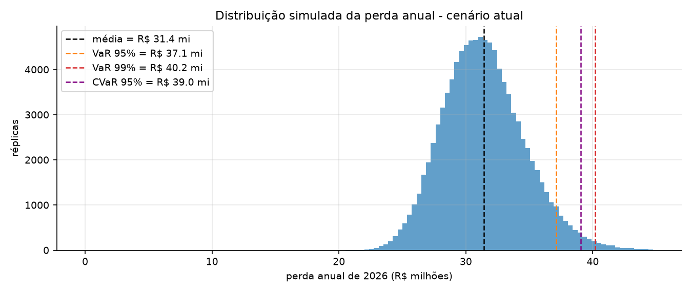
*Figura `q14b_distribuicao`* Perda anual simulada (cenário atual) com as métricas de risco.


### 14-c) Convergência


**Tabela `q14c_convergencia`** Estimativas com as primeiras n réplicas.

|         |   média (R$ mi) |   erro padrão da média (R$ mi) |   VaR 95% (R$ mi) |   EP relativo ao de n = 1.000 |   1/√(n/1.000) teórico |
|--------:|----------------:|-------------------------------:|------------------:|------------------------------:|-----------------------:|
|   1,000 |         31.5124 |                         0.1098 |           37.5020 |                        1.0000 |                 1.0000 |
|   4,000 |         31.4125 |                         0.0526 |           37.2908 |                        0.4790 |                 0.5000 |
|  16,000 |         31.4578 |                         0.0261 |           37.2173 |                        0.2376 |                 0.2500 |
|  64,000 |         31.4349 |                         0.0129 |           37.1147 |                        0.1176 |                 0.1250 |
| 100,000 |         31.4331 |                         0.0103 |           37.1120 |                        0.0941 |                 0.1000 |


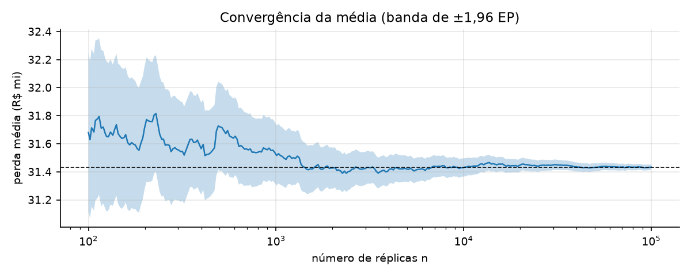
*Figura `q14c_convergencia`* A banda de incerteza encolhe na proporção 1/√n.


### 14-d) Cenário com controles


**Tabela `q14d_comparativo`** Formato da Seção 12.7.3 (valores em R$ milhões; probabilidade em fração).

|                     |   Atual |   Com controles |   Redução |   Redução (%) |
|:--------------------|--------:|----------------:|----------:|--------------:|
| média               |  31.433 |           9.417 |    22.016 |        70.041 |
| mediana             |  31.227 |           9.241 |    21.986 |        70.408 |
| desvio-padrão       |   3.268 |           1.723 |     1.545 |        47.271 |
| VaR 95%             |  37.112 |          12.477 |    24.635 |        66.381 |
| VaR 99%             |  40.193 |          14.361 |    25.832 |        64.270 |
| CVaR 95%            |  39.049 |          13.663 |    25.386 |        65.011 |
| CVaR 99%            |  42.151 |          15.614 |    26.536 |        62.956 |
| P(perda > R$ 30 mi) |   0.653 |           0.000 |     0.653 |       100.000 |


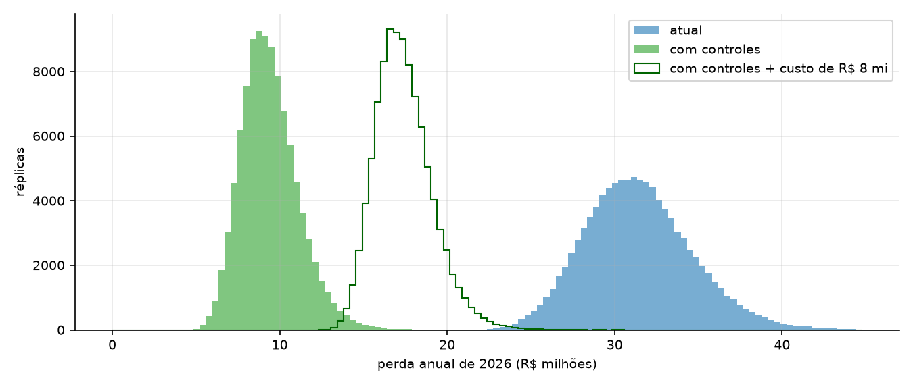
*Figura `q14d_comparacao`* O pacote desloca toda a distribuição para a esquerda.


### 14-e) Decisão

- `q14e.redução da perda média (R$ mi)` = 22.0160
- `q14e.erro padrão da redução (R$ mi)` = 0.0073
- `q14e.benefício líquido médio (R$ mi)` = 14.0160
- `q14e.ROI (%)` = 175.2000
- `q14e.P(perda c/ controles + custo > perda atual)` = 0.0000
- `q14e.custo máximo que se paga na média (R$ mi)` = 22.0160
- `q14e.redução do VaR 95% (R$ mi)` = 24.6354
- `q14e.redução do CVaR 95% (R$ mi)` = 25.3861

### 14-f) Sensibilidade


**Tabela `q14f_sensibilidade`** n = 50,000 réplicas por caso, mesmas sementes.

|                            |   perda média atual (R$ mi) |   VaR 95% atual (R$ mi) |   redução média (R$ mi) |   benefício líquido (R$ mi) |   ROI (%) |   P(não se pagar no ano) | decisão   |
|:---------------------------|----------------------------:|------------------------:|------------------------:|----------------------------:|----------:|-------------------------:|:----------|
| ('σ × 0.8', 'freq. × 0.9') |                      23.852 |                  27.576 |                  16.715 |                       8.715 |   108.932 |                    0.000 | investir  |
| ('σ × 0.8', 'freq. × 1.0') |                      26.510 |                  30.420 |                  18.575 |                      10.575 |   132.192 |                    0.000 | investir  |
| ('σ × 0.8', 'freq. × 1.1') |                      29.147 |                  33.288 |                  20.423 |                      12.423 |   155.288 |                    0.000 | investir  |
| ('σ × 1.0', 'freq. × 0.9') |                      28.282 |                  33.687 |                  19.812 |                      11.812 |   147.646 |                    0.000 | investir  |
| ('σ × 1.0', 'freq. × 1.0') |                      31.431 |                  37.113 |                  22.017 |                      14.017 |   175.212 |                    0.000 | investir  |
| ('σ × 1.0', 'freq. × 1.1') |                      34.551 |                  40.563 |                  24.200 |                      16.200 |   202.505 |                    0.000 | investir  |
| ('σ × 1.2', 'freq. × 0.9') |                      34.837 |                  43.223 |                  24.393 |                      16.393 |   204.916 |                    0.000 | investir  |
| ('σ × 1.2', 'freq. × 1.0') |                      38.712 |                  47.597 |                  27.108 |                      19.108 |   238.851 |                    0.000 | investir  |
| ('σ × 1.2', 'freq. × 1.1') |                      42.548 |                  51.874 |                  29.787 |                      21.787 |   272.337 |                    0.000 | investir  |

- `q14f.casos_em_que_a_decisao_muda` = 0

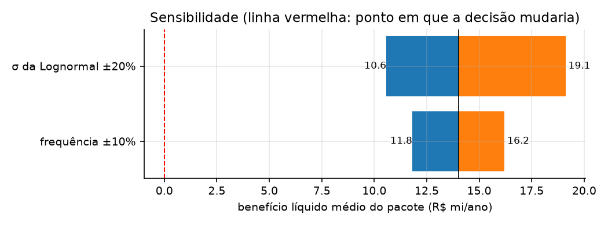
*Figura `q14f_tornado`* Tornado: azul = parâmetro para baixo; laranja = para cima.


### 14-g) Erro de modelo: gerador verdadeiro em 2026 (10.000 anos)


**Tabela `q14g_erro_modelo`** R$ milhões (probabilidade em fração). Cenário atual.

|                     |   SMC com modelos estimados (b) |   Gerador verdadeiro (g) |   erro (estimado − verdadeiro) |   erro (%) |
|:--------------------|--------------------------------:|-------------------------:|-------------------------------:|-----------:|
| média               |                          31.433 |                   34.116 |                         -2.683 |     -7.865 |
| mediana             |                          31.227 |                   33.812 |                         -2.585 |     -7.646 |
| desvio-padrão       |                           3.268 |                    3.659 |                         -0.390 |    -10.671 |
| VaR 95%             |                          37.112 |                   40.389 |                         -3.277 |     -8.114 |
| VaR 99%             |                          40.193 |                   44.091 |                         -3.898 |     -8.841 |
| CVaR 95%            |                          39.049 |                   42.919 |                         -3.870 |     -9.017 |
| CVaR 99%            |                          42.151 |                   47.776 |                         -5.625 |    -11.774 |
| P(perda > R$ 30 mi) |                           0.653 |                    0.881 |                         -0.228 |    -25.843 |


**Tabela `q14g_componentes`** De onde vem o erro: frequência, materialização ou severidade.

|                          |   estimado |   verdadeiro |   erro (%) |
|:-------------------------|-----------:|-------------:|-----------:|
| ataques por ano          |  1,094.846 |    1,140.009 |     -3.962 |
| eventos de perda por ano |    464.057 |      485.925 |     -4.500 |
| prob. de materialização  |      0.424 |        0.426 |     -0.561 |
| severidade média (R$)    | 67,742.104 |   70,209.236 |     -3.514 |

- `q14g.erro_padrao_media_verdadeira_mi` = 0.0366

**Tabela `q14g_decisao`** A decisão sobrevive ao erro de modelo?

|                                             |   estimado (Parte C) |   verdadeiro (gerador) |
|:--------------------------------------------|---------------------:|-----------------------:|
| redução da perda média (R$ mi)              |               22.016 |                 23.330 |
| erro padrão da redução (R$ mi)              |                0.007 |                  0.040 |
| benefício líquido médio (R$ mi)             |               14.016 |                 15.330 |
| ROI (%)                                     |              175.200 |                191.625 |
| P(perda c/ controles + custo > perda atual) |                0.000 |                  0.000 |
| custo máximo que se paga na média (R$ mi)   |               22.016 |                 23.330 |
| redução do VaR 95% (R$ mi)                  |               24.635 |                 26.421 |
| redução do CVaR 95% (R$ mi)                 |               25.386 |                 27.967 |


**Tabela `q14g_comparativo_verdadeiro`** Atual x controles com os parâmetros verdadeiros (R$ milhões).

|                     |   Atual |   Com controles |   Redução |   Redução (%) |
|:--------------------|--------:|----------------:|----------:|--------------:|
| média               |  34.116 |          10.786 |    23.330 |        68.383 |
| mediana             |  33.812 |          10.629 |    23.183 |        68.563 |
| desvio-padrão       |   3.659 |           1.772 |     1.887 |        51.579 |
| VaR 95%             |  40.389 |          13.968 |    26.421 |        65.416 |
| VaR 99%             |  44.091 |          15.571 |    28.520 |        64.684 |
| CVaR 95%            |  42.919 |          14.952 |    27.967 |        65.163 |
| CVaR 99%            |  47.776 |          16.569 |    31.206 |        65.318 |
| P(perda > R$ 30 mi) |   0.881 |           0.000 |     0.881 |       100.000 |


**Tabela `q14g_quantis`** Quantis da perda anual (R$ milhões).

|       |   estimado |   verdadeiro |   razão est./verd. |
|:------|-----------:|-------------:|-------------------:|
| P50   |     31.227 |       33.812 |              0.924 |
| P75   |     33.428 |       36.248 |              0.922 |
| P90   |     35.664 |       38.697 |              0.922 |
| P95   |     37.112 |       40.389 |              0.919 |
| P99   |     40.193 |       44.091 |              0.912 |
| P99.9 |     44.762 |       52.956 |              0.845 |


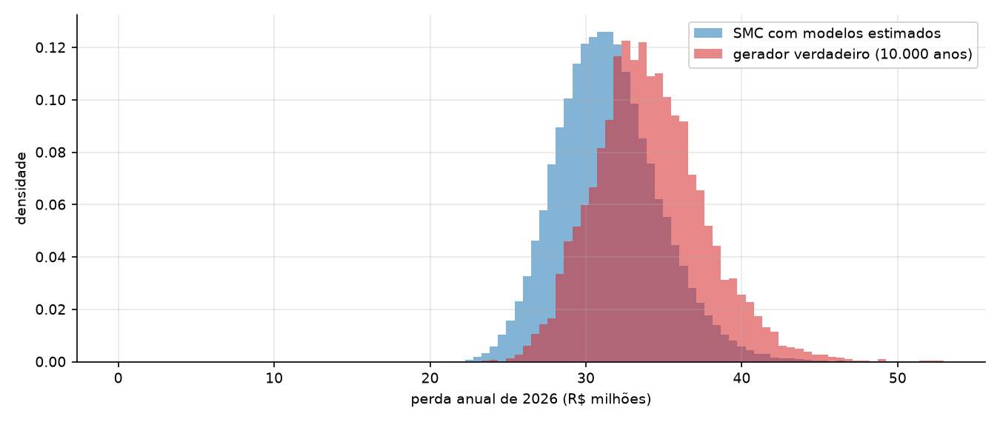
*Figura `q14g_erro_modelo`* Distribuição 'verdadeira' x distribuição da SMC de decisão.
